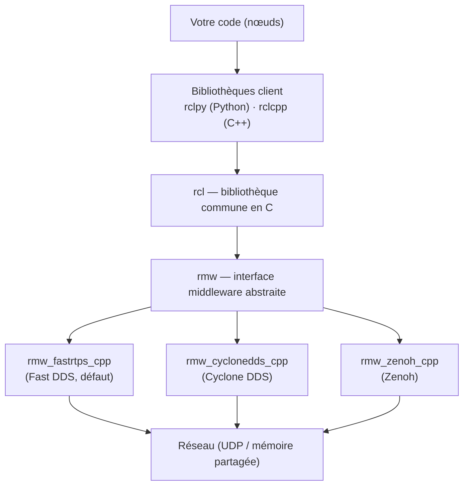
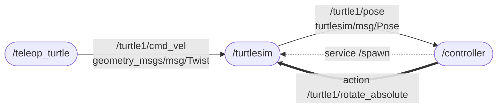

# 01 – Concepts de ROS 2 et prise en main par la CLI

## Objectifs pédagogiques

À l'issue de ce chapitre, l'étudiant sera capable de :

| Niveau (Bloom) | Objectif |
| --- | --- |
| Se souvenir | Nommer les cinq mécanismes du graphe de calcul (nœud, topic, service, action, paramètre). |
| Comprendre | Expliquer le rôle des couches rcl, rmw et DDS, et le mécanisme de découverte. |
| Appliquer | Inspecter et piloter un système ROS 2 en cours d'exécution avec la CLI `ros2`. |
| Analyser | Choisir le mécanisme de communication adapté à un besoin donné (flux, requête ponctuelle, tâche longue). |

**Prérequis** : conteneur fonctionnel (voir le [README du dépôt](../../README.md)).

---

## Sommaire

- [1. Qu'est-ce que ROS 2 ?](#1-quest-ce-que-ros-2-)
- [2. Architecture logicielle](#2-architecture-logicielle)
- [3. Le graphe de calcul](#3-le-graphe-de-calcul)
- [4. Prise en main avec turtlesim](#4-prise-en-main-avec-turtlesim)
  - [4.1 Packages et exécutables](#41-packages-et-exécutables)
  - [4.2 Nœuds](#42-nœuds)
  - [4.3 Topics](#43-topics)
  - [4.4 Interfaces](#44-interfaces)
  - [4.5 Services](#45-services)
  - [4.6 Paramètres](#46-paramètres)
  - [4.7 Actions](#47-actions)
  - [4.8 Remapping et namespaces](#48-remapping-et-namespaces)
  - [4.9 Lancer plusieurs nœuds : `ros2 launch`](#49-lancer-plusieurs-nœuds--ros2-launch)
- [5. Aide-mémoire CLI](#5-aide-mémoire-cli)
- [6. Exercices](#6-exercices)
- [7. Questions d'évaluation](#7-questions-dévaluation)

---

## 1. Qu'est-ce que ROS 2 ?

Contrairement à ce que son nom suggère, ROS 2 (*Robot Operating System 2*) n'est pas un système d'exploitation. C'est un **middleware** accompagné d'un écosystème :

- un **modèle de communication** entre processus (publication/abonnement, requête/réponse, tâches longues) ;
- des **outils** d'introspection, d'enregistrement et de visualisation ;
- des milliers de **packages** réutilisables (pilotes, perception, navigation, manipulation…).

ROS 2 est une refonte de ROS 1 (dont la dernière distribution, Noetic, est en fin de vie depuis mai 2025). Elle répond à des besoins que ROS 1 couvrait mal :

| Besoin | Réponse de ROS 2 | Nuance |
| --- | --- | --- |
| Pas de point central de défaillance | Découverte décentralisée via DDS (plus de `roscore`) | La découverte multicast peut poser problème sur certains réseaux (Wi-Fi, VPN). |
| Communication configurable | Profils de **QoS** (fiabilité, durabilité, historique) | Des QoS incompatibles bloquent la communication ; seul un avertissement apparaît dans les logs. |
| Sécurité | SROS2 / DDS-Security (authentification, chiffrement) | Désactivée par défaut, à configurer explicitement. |
| Temps réel | API compatible avec un ordonnancement temps réel (rclcpp, allocateurs, executors dédiés) | ROS 2 **n'est pas temps réel par défaut** : il faut un noyau PREEMPT_RT, du C++ et une conception adaptée. `rclpy` n'est pas déterministe. |
| Multi-plateforme | Linux (Tier 1), Windows, macOS ; microcontrôleurs via micro-ROS | Seul Ubuntu LTS est pleinement supporté pour chaque distribution. |

### Distributions

Une **distribution** est un ensemble versionné et cohérent de packages. Une nouvelle distribution sort chaque année le 23 mai (*World Turtle Day*). Celles des années paires sont des LTS supportées 5 ans.

| Distribution | Sortie | Ubuntu | Fin de support |
| --- | --- | --- | --- |
| Humble Hawksbill | 2022 | 22.04 | mai 2027 |
| **Jazzy Jalisco** (ce cours) | 2024 | 24.04 | mai 2029 |
| Kilted Kaiju | 2025 | 24.04 | déc. 2026 |
| Lyrical Luth | 2026 | 26.04 | mai 2031 |

```bash
echo $ROS_DISTRO        # affiche la distribution active : jazzy
ros2 doctor --report    # diagnostic complet de l'installation et du réseau
```

---

## 2. Architecture logicielle



- **rclpy / rclcpp** : API utilisées dans le code. Elles partagent la même implémentation de base (`rcl`), ce qui garantit un comportement cohérent entre Python et C++.
- **rmw** (*ROS middleware interface*) : couche d'abstraction qui permet de **changer de middleware sans changer le code** :
  ```bash
  export RMW_IMPLEMENTATION=rmw_cyclonedds_cpp
  ```
- **DDS** (*Data Distribution Service*, norme OMG) : assure la découverte des participants, la sérialisation et le transport.

### Découverte et `ROS_DOMAIN_ID`

Les nœuds se découvrent **automatiquement** sur le réseau local, sans serveur central. Pour isoler plusieurs systèmes partageant un même réseau (une salle de TP, par exemple), on utilise un identifiant de domaine :

```bash
export ROS_DOMAIN_ID=12                    # entier entre 0 et 101 (valeur par défaut : 0)
export ROS_AUTOMATIC_DISCOVERY_RANGE=LOCALHOST   # restreint la découverte à la machine locale
```

> ⚠️ Le conteneur utilise `--network=host`. Sans `ROS_DOMAIN_ID` distinct, vous verrez les tortues de vos voisins.

---

## 3. Le graphe de calcul

Une application ROS 2 est un **graphe** dont les sommets sont des nœuds et les arêtes des canaux de communication.



| Mécanisme | Modèle | Cardinalité | Usage typique | Interface |
| --- | --- | --- | --- | --- |
| **Nœud** | Unité de calcul (un ou plusieurs par processus) | — | Pilote de capteur, estimateur, contrôleur | — |
| **Topic** | Publication / abonnement, asynchrone | N → M | Flux continus : capteurs, commandes, états | `.msg` |
| **Service** | Requête / réponse | N clients → 1 serveur | Requête ponctuelle et courte : reset, calcul, configuration | `.srv` |
| **Action** | Objectif / retour d'état / résultat, annulable | N clients → 1 serveur | Tâche longue : aller à une pose, saisir un objet | `.action` |
| **Paramètre** | Valeur nommée attachée à un nœud | — | Gains, seuils, chemins de fichiers | types primitifs et tableaux |

**Règle de choix** :
- s'il s'agit d'un flux de données, utilisez un **topic** ;
- si l'appelant attend une réponse rapide (de l'ordre de la milliseconde à quelques centaines de millisecondes), utilisez un **service** ;
- si la tâche dure, doit fournir sa progression ou pouvoir être annulée, utilisez une **action**.

> En interne, une action est implémentée avec **trois services** (`send_goal`, `cancel_goal`, `get_result`) et **deux topics** (`feedback`, `status`).

---

## 4. Prise en main avec turtlesim

`turtlesim` est un simulateur 2D minimaliste. Il expose tous les mécanismes du graphe de calcul, ce qui en fait un terrain d'apprentissage idéal.

```bash
T1$ ros2 run turtlesim turtlesim_node
T2$ ros2 run turtlesim turtle_teleop_key      # piloter avec les flèches (le focus doit être sur T2)
```

### 4.1 Packages et exécutables

```bash
ros2 pkg list                       # tous les packages installés
ros2 pkg executables turtlesim      # exécutables fournis par turtlesim
ros2 pkg prefix turtlesim           # dossier d'installation
```

Syntaxe générale : `ros2 run <package> <exécutable> [--ros-args ...]`.

### 4.2 Nœuds

```bash
ros2 node list
ros2 node info /turtlesim           # abonnements, publications, services, actions du nœud
```

### 4.3 Topics

```bash
ros2 topic list -t                          # -t : affiche aussi le type
ros2 topic info /turtle1/cmd_vel -v         # -v : publishers, subscribers et leurs QoS
ros2 topic echo /turtle1/pose               # affiche les messages reçus
ros2 topic echo /turtle1/pose --once        # un seul message
ros2 topic echo /turtle1/pose --field x     # un seul champ
ros2 topic hz /turtle1/pose                 # fréquence de publication
ros2 topic bw /turtle1/pose                 # bande passante
```

Publier depuis la CLI :

```bash
# Un seul message
ros2 topic pub --once /turtle1/cmd_vel geometry_msgs/msg/Twist \
  "{linear: {x: 2.0, y: 0.0, z: 0.0}, angular: {x: 0.0, y: 0.0, z: 1.8}}"

# En continu à 10 Hz (Ctrl+C pour arrêter) : la tortue décrit un cercle
ros2 topic pub -r 10 /turtle1/cmd_vel geometry_msgs/msg/Twist \
  "{linear: {x: 2.0}, angular: {z: 1.0}}"
```

> Sans `--once` ni `-r`, `ros2 topic pub` publie en continu à **1 Hz**. Les champs non précisés valent 0.

### 4.4 Interfaces

Les types de messages, services et actions sont appelés **interfaces**.

```bash
ros2 interface list                               # toutes les interfaces
ros2 interface package turtlesim                  # interfaces d'un package
ros2 interface show geometry_msgs/msg/Twist       # définition d'un message
ros2 interface show turtlesim/srv/Spawn           # requête --- réponse
ros2 interface show turtlesim/action/RotateAbsolute   # goal --- result --- feedback
ros2 interface proto geometry_msgs/msg/Twist      # gabarit YAML à copier dans ros2 topic pub
```

> Les commandes `ros2 msg` et `ros2 srv`, présentes dans les premières versions de ROS 2, n'existent plus : utilisez `ros2 interface`.

### 4.5 Services

```bash
ros2 service list -t
ros2 service type /spawn
ros2 service find turtlesim/srv/TeleportAbsolute

ros2 service call /clear std_srvs/srv/Empty
ros2 service call /spawn turtlesim/srv/Spawn "{x: 2.0, y: 2.0, theta: 0.0, name: 'turtle2'}"
ros2 service call /turtle1/teleport_absolute turtlesim/srv/TeleportAbsolute "{x: 5.5, y: 5.5, theta: 1.57}"
ros2 service call /turtle1/set_pen turtlesim/srv/SetPen "{r: 255, g: 0, b: 0, width: 3, 'off': 0}"
```

> `off` est un mot réservé en YAML (il vaut `false`), d'où les guillemets.

### 4.6 Paramètres

```bash
ros2 param list /turtlesim
ros2 param describe /turtlesim background_r      # type, description, contraintes
ros2 param get /turtlesim background_r
ros2 param set /turtlesim background_r 150
ros2 param dump /turtlesim > turtlesim.yaml      # sauvegarde au format YAML
ros2 param load /turtlesim turtlesim.yaml        # rechargement
ros2 run turtlesim turtlesim_node --ros-args --params-file turtlesim.yaml   # au démarrage
```

> Les paramètres sont **typés**. `ros2 param set /turtlesim background_r 150.0` échoue, car le paramètre est un entier.

### 4.7 Actions

```bash
ros2 action list -t
ros2 action info /turtle1/rotate_absolute        # serveur et clients
ros2 action send_goal /turtle1/rotate_absolute turtlesim/action/RotateAbsolute \
  "{theta: -1.57}" --feedback
```

Le nœud `turtle_teleop_key` est lui-même un **client** de cette action : les touches `G B V C D E R T` envoient un objectif d'orientation absolue, et `F` annule l'objectif en cours. Deux expériences sont à observer dans le terminal de `turtlesim_node` :
- appuyez sur `C`, puis sur `F` avant la fin de la rotation : l'objectif est **annulé** (*canceled*) ;
- appuyez sur `D`, puis sur `G` avant la fin de la rotation : le nouvel objectif **interrompt** le précédent (*aborted*), car ce serveur ne traite qu'un objectif à la fois.

### 4.8 Remapping et namespaces

Tout nom (nœud, topic, service) peut être modifié **au lancement**, sans toucher au code :

```bash
# Renommer le nœud
ros2 run turtlesim turtlesim_node --ros-args -r __node:=ma_tortue

# Placer tout le nœud dans un namespace
ros2 run turtlesim turtlesim_node --ros-args -r __ns:=/robot1

# Rediriger un topic : la teleop pilote turtle2 au lieu de turtle1
ros2 run turtlesim turtle_teleop_key --ros-args -r /turtle1/cmd_vel:=/turtle2/cmd_vel
```

Les noms **relatifs** (sans `/` initial) sont résolus dans le namespace du nœud. Les noms **absolus** (avec `/`) ne le sont pas. C'est pourquoi il faut privilégier les noms relatifs dans le code, ce qui permet de lancer plusieurs robots identiques dans des namespaces distincts.

### 4.9 Lancer plusieurs nœuds : `ros2 launch`

Un **launch file** décrit un ensemble de nœuds avec leurs paramètres, leurs remappings et leurs namespaces. Leur écriture est traitée au chapitre 08 ; ici, on se contente de les utiliser :

```bash
ros2 launch turtlesim multisim.launch.py     # deux simulateurs dans les namespaces /turtlesim1 et /turtlesim2
ros2 node list
ros2 topic pub -r 10 /turtlesim2/turtle1/cmd_vel geometry_msgs/msg/Twist "{linear: {x: 1.0}, angular: {z: 1.0}}"
```

---

## 5. Aide-mémoire CLI

| Commande | Rôle |
| --- | --- |
| `ros2 run <pkg> <exe>` | Lancer un exécutable |
| `ros2 launch <pkg> <fichier.launch.py>` | Lancer un ensemble de nœuds |
| `ros2 node list` / `info` | Lister / inspecter les nœuds |
| `ros2 topic list -t` / `info -v` / `echo` / `hz` / `pub` | Topics |
| `ros2 service list -t` / `type` / `call` | Services |
| `ros2 action list -t` / `info` / `send_goal --feedback` | Actions |
| `ros2 param list` / `get` / `set` / `dump` / `load` | Paramètres |
| `ros2 interface list` / `show` / `proto` | Définitions d'interfaces |
| `ros2 pkg list` / `executables` / `create` | Packages |
| `ros2 bag record` / `play` / `info` | Enregistrement (chapitre 02) |
| `ros2 doctor` | Diagnostic |
| `--ros-args -r a:=b -p nom:=valeur --params-file f.yaml --log-level debug` | Arguments ROS passés à tout nœud |

Toutes les commandes acceptent `-h` et l'autocomplétion par `Tab`.

---

## 6. Exercices

**Exercice 1 – Cartographier le graphe.** Lancez `turtlesim_node` et `turtle_teleop_key`. En n'utilisant **que** la CLI, dressez la liste des topics, services et actions exposés par chaque nœud, avec leur type. Indiquez pour chacun s'il est publié ou souscrit (ou s'il s'agit d'un serveur ou d'un client).

**Exercice 2 – Dessiner un carré.** Avec `ros2 service call` (téléportation, `set_pen`) et `ros2 topic pub --once`, faites tracer à la tortue un carré rouge de côté 3 centré dans la fenêtre. Quelle limite de la commande en boucle ouverte observez-vous ?

**Exercice 3 – Deux tortues.** Faites apparaître `turtle2`, puis lancez une seconde instance de `turtle_teleop_key` qui la pilote. Proposez deux solutions : remapping de topic, puis namespace.

**Exercice 4 – Mesures.** Mesurez la fréquence de publication de `/turtle1/pose`. Quel profil de QoS (fiabilité, durabilité) utilise ce publisher ?

---

## 7. Questions d'évaluation

1. Pourquoi ROS 2 n'a-t-il plus besoin d'un `roscore` ? Quel inconvénient cela introduit-il sur un réseau Wi-Fi ?
2. Quel est le rôle de la couche `rmw` ? Citez un cas où changer de `RMW_IMPLEMENTATION` est pertinent.
3. Un nœud de planification doit demander une trajectoire à un planificateur dont le calcul prend 2 s. Service ou action ? Justifiez.
4. Quelle différence de résolution y a-t-il entre `cmd_vel` et `/cmd_vel` lorsqu'un nœud est lancé avec `-r __ns:=/robot1` ?
5. Vrai ou faux : « ROS 2 garantit le temps réel ». Argumentez.
