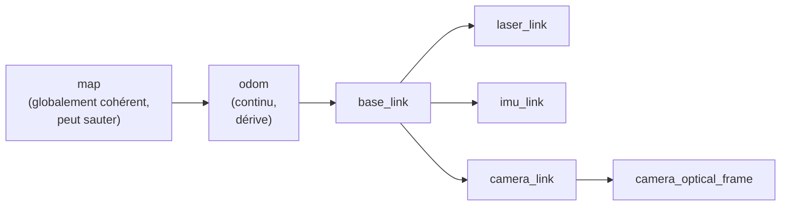

# 02 – Outils : rqt, ros2 bag, TF2 et rviz2

## Objectifs pédagogiques

À la fin de ce chapitre, vous saurez :

- expliquer comment TF2 organise les repères d'un robot en arbre, et les conventions de nommage des repères (REP 103 et REP 105) ;
- afficher le graphe des nœuds (`rqt_graph`), tracer un signal (`rqt_plot`), enregistrer et rejouer des données (`ros2 bag`) ;
- publier une transformation fixe entre deux repères et lire la transformation entre deux repères quelconques ;
- trouver la cause d'une panne (topic non connecté, transformation manquante) à l'aide de ces outils.

**Prérequis** : [01 – Concepts et CLI](01_concepts_et_cli.md).

Si un outil manque dans l'image :
```bash
sudo apt update && sudo apt install -y ros-jazzy-rqt ros-jazzy-rqt-common-plugins \
  ros-jazzy-rqt-tf-tree ros-jazzy-rviz2 ros-jazzy-turtle-tf2-py ros-jazzy-tf2-tools ros-jazzy-tf2-ros
```

---

## Sommaire

- [1. rqt : boîte à outils graphique](#1-rqt--boîte-à-outils-graphique)
- [2. ros2 bag : enregistrer et rejouer](#2-ros2-bag--enregistrer-et-rejouer)
- [3. TF2 : gérer les repères](#3-tf2--gérer-les-repères)
- [4. rviz2 : visualisation 3D](#4-rviz2--visualisation-3d)
- [5. Exercices](#5-exercices)
- [6. Questions d'évaluation](#6-questions-dévaluation)

---

## 1. rqt : boîte à outils graphique

`rqt` est un cadre d'interfaces graphiques à base de *plugins*. On peut lancer `rqt` puis ajouter les plugins depuis le menu *Plugins*, ou lancer chaque plugin directement :

| Plugin | Commande | Usage |
| --- | --- | --- |
| Graphe de calcul | `ros2 run rqt_graph rqt_graph` | Visualiser nœuds et topics : **premier réflexe de débogage** |
| Tracé temporel | `ros2 run rqt_plot rqt_plot /turtle1/pose/x /turtle1/pose/theta` | Tracer des champs numériques |
| Console | `ros2 run rqt_console rqt_console` | Filtrer les logs par nœud et par niveau |
| Paramètres | `ros2 run rqt_reconfigure rqt_reconfigure` | Modifier les paramètres en direct (curseurs) |
| Topics | `ros2 run rqt_topic rqt_topic` | Inspecter les messages, débit, fréquence |
| Services | `ros2 run rqt_service_caller rqt_service_caller` | Appeler un service via un formulaire |
| Publication | `ros2 run rqt_publisher rqt_publisher` | Publier des messages (expressions possibles) |
| Arbre TF | `ros2 run rqt_tf_tree rqt_tf_tree` | Visualiser l'arbre de repères |

### Mise en pratique

```bash
T1$ ros2 run turtlesim turtlesim_node
T2$ ros2 run turtlesim turtle_teleop_key
T3$ ros2 run rqt_graph rqt_graph
T4$ ros2 run rqt_plot rqt_plot /turtle1/pose/x /turtle1/pose/y
```

Dans `rqt_graph`, décochez *Hide: Dead sinks / Leaf topics* pour voir tous les topics. Le menu déroulant *Nodes/Topics (all)* affiche aussi les topics sans abonné.

---

## 2. ros2 bag : enregistrer et rejouer

`rosbag2` enregistre les messages de topics dans un fichier horodaté. Depuis Iron, le format par défaut est **MCAP**, lisible aussi par des outils externes comme Foxglove. On l'utilise pour :
- rejouer un scénario de façon reproductible (mise au point d'un algorithme de perception ou d'estimation hors ligne) ;
- constituer des jeux de données (apprentissage, évaluation) ;
- analyser *a posteriori* un incident.

```bash
# Enregistrer certains topics (Ctrl+C pour arrêter)
ros2 bag record -o run_carre /turtle1/cmd_vel /turtle1/pose

# Tout enregistrer (attention au volume avec des caméras ou des lidars)
ros2 bag record -a -o run_complet

# Inspecter : durée, nombre de messages, types
ros2 bag info run_carre

# Rejouer
ros2 bag play run_carre                         # tous les topics
ros2 bag play run_carre --topics /turtle1/cmd_vel   # un sous-ensemble
ros2 bag play run_carre --rate 2.0 --loop       # vitesse x2, en boucle
```

> **Piège classique.** Si l'on rejoue `/turtle1/pose` alors que `turtlesim_node` tourne, deux publishers coexistent sur le même topic et les abonnés reçoivent des poses contradictoires. Ne rejouez que les entrées du système (ici `cmd_vel`), ou renommez les sorties : `--remap /turtle1/pose:=/bag/pose`.

**Temps simulé.** Pour qu'un nœud utilise l'horloge du bag plutôt que l'horloge système, rejouez avec `--clock` et lancez les nœuds avec `--ros-args -p use_sim_time:=true`. Ce mécanisme est aussi celui utilisé avec un simulateur comme Gazebo.

---

## 3. TF2 : gérer les repères

### 3.1 Fondements

Un robot manipule de nombreux repères : monde, odométrie, base, capteurs, effecteurs… TF2 maintient un **arbre** (graphe orienté sans cycle, chaque repère ayant au plus un parent) de transformations rigides horodatées. Il répond à une question : *quelle est la pose du repère $B$ exprimée dans le repère $A$ à l'instant $t$ ?*

Chaque arête porte une transformation homogène de $SE(3)$ :

$$
{}^{A}T_{B} = \begin{bmatrix} {}^{A}R_{B} & {}^{A}\mathbf{p}_{B} \\ \mathbf{0}^\top & 1 \end{bmatrix}, \qquad {}^{A}R_{B} \in SO(3),\ {}^{A}\mathbf{p}_{B} \in \mathbb{R}^3
$$

TF2 compose les transformations le long du chemin dans l'arbre :

$$
{}^{A}T_{C}(t) = {}^{A}T_{B}(t)\,{}^{B}T_{C}(t), \qquad {}^{B}T_{A} = \left({}^{A}T_{B}\right)^{-1}
$$

Les rotations sont transmises sous forme de **quaternions unitaires** $(x, y, z, w)$, ce qui évite le blocage de cardan.

Les transformations passent par deux topics :

| Topic | Contenu | QoS |
| --- | --- | --- |
| `/tf` | Transformations **dynamiques** (odométrie, articulations), publiées en continu | volatile |
| `/tf_static` | Transformations **statiques** (montage d'un capteur), publiées une seule fois | *transient local* : un nœud arrivant plus tard les reçoit quand même |

Chaque nœud qui interroge TF2 garde un **tampon** (*buffer*, 10 s par défaut) et peut **interpoler** entre deux échantillons. Demander une transformation à un instant hors du tampon lève une exception `ExtrapolationException`.

### 3.2 Conventions (REP 103 et REP 105)

- **REP 103** : unités SI. Pour la base d'un robot, l'axe $x$ pointe vers l'avant, $y$ vers la gauche et $z$ vers le haut. Les repères optiques des caméras suivent une autre convention (suffixe `_optical_frame` : $z$ vers l'avant, $x$ vers la droite, $y$ vers le bas).
- **REP 105** : chaîne canonique d'un robot mobile



  - `odom → base_link` est publiée par l'odométrie (roues, odométrie visuelle-inertielle, `robot_localization`). Elle est **continue mais dérive**.
  - `map → odom` est publiée par la localisation ou le SLAM (AMCL, `slam_toolbox`). Elle **corrige la dérive** et peut présenter des sauts.
  - `base_link → capteurs` est statique, publiée par `robot_state_publisher` à partir de l'URDF.

### 3.3 Démonstration : une tortue en suit une autre

```bash
T1$ ros2 launch turtle_tf2_py turtle_tf2_demo.launch.py
T2$ ros2 run turtlesim turtle_teleop_key
```

`turtle2` poursuit `turtle1`. Deux *broadcasters* publient `world → turtle1` et `world → turtle2` ; un *listener* calcule ${}^{turtle2}T_{turtle1}$ et en déduit une commande.

```bash
ros2 run tf2_ros tf2_echo turtle2 turtle1     # pose de turtle1 dans le repère de turtle2
ros2 run tf2_tools view_frames                # génère frames_<date>.pdf (arbre, fréquences, retards)
ros2 run rqt_tf_tree rqt_tf_tree              # même information, en direct
```

### 3.4 Publier une transformation statique

Exemple : un lidar monté 20 cm devant et 15 cm au-dessus de la base, tourné de 90° autour de $z$.

```bash
ros2 run tf2_ros static_transform_publisher \
  --x 0.2 --y 0.0 --z 0.15 --yaw 1.5708 --pitch 0.0 --roll 0.0 \
  --frame-id base_link --child-frame-id laser_link
```

> Dans un vrai robot, ces transformations sont décrites dans l'**URDF** et publiées par `robot_state_publisher`, pas à la main.

---

## 4. rviz2 : visualisation 3D

`rviz2` affiche dans une scène 3D les données exprimées dans des repères TF : nuages de points, scans laser, images, cartes, trajectoires, marqueurs, modèle du robot.

```bash
T1$ ros2 launch turtle_tf2_py turtle_tf2_demo.launch.py
T2$ ros2 run turtlesim turtle_teleop_key
T3$ rviz2
```

1. Dans *Global Options*, réglez **Fixed Frame** sur `world`. C'est le repère dans lequel tout est affiché : il doit exister dans l'arbre TF.
2. *Add* → **TF** : les repères `world`, `turtle1`, `turtle2` apparaissent et bougent.
3. *Add* → onglet *By topic* : rviz2 propose les affichages compatibles avec les topics existants.
4. *File* → *Save Config As* → `turtle.rviz`, puis relancez avec `rviz2 -d turtle.rviz`.

| Display | Type de message | Usage |
| --- | --- | --- |
| `TF` | `/tf`, `/tf_static` | Arbre de repères |
| `RobotModel` | `/robot_description` (URDF) | Modèle 3D du robot |
| `LaserScan` | `sensor_msgs/msg/LaserScan` | Lidar 2D |
| `PointCloud2` | `sensor_msgs/msg/PointCloud2` | Lidar 3D, caméra de profondeur |
| `Image` | `sensor_msgs/msg/Image` | Caméra |
| `Map` | `nav_msgs/msg/OccupancyGrid` | Carte d'occupation |
| `Path` / `Odometry` | `nav_msgs/msg/Path`, `nav_msgs/msg/Odometry` | Trajectoires, estimation |
| `Marker(Array)` | `visualization_msgs/msg/Marker(Array)` | Formes de débogage publiées par votre code |

> **Diagnostic.** Un display en erreur affichant *« No transform from [X] to [world] »* signale un problème TF : un repère n'est pas publié, l'arbre est déconnecté, ou les horodatages sont incohérents (pensez à `use_sim_time`).

---

## 5. Exercices

**Exercice 1 – Diagnostic.** Lancez `turtlesim_node`, puis `turtle_teleop_key --ros-args -r /turtle1/cmd_vel:=/turtle/cmd_vel`. La tortue ne bouge pas. Identifiez la cause avec `rqt_graph` puis avec la CLI, et corrigez-la **sans relancer** les nœuds existants (en ajoutant un nœud).

**Exercice 2 – Rejeu.** Enregistrez un bag de `/turtle1/cmd_vel` pendant que vous pilotez la tortue. Relancez `turtlesim_node`, puis rejouez le bag. La trajectoire est-elle identique ? Expliquez les écarts (conditions initiales, gigue temporelle, intégration en boucle ouverte).

**Exercice 3 – Repère capteur.** Pendant la démo `turtle_tf2_demo`, publiez un repère statique `turtle1 → camera` décalé de 0,5 m vers l'avant. Vérifiez-le dans rviz2 et avec `tf2_echo world camera`. Pourquoi la pose de `camera` dans `world` varie-t-elle alors que la transformation publiée est statique ?

**Exercice 4 – Tracé.** Avec `rqt_plot`, tracez $\theta$ de `turtle1` pendant un `ros2 action send_goal` sur `/turtle1/rotate_absolute`. Le profil de vitesse est-il constant ?

---

## 6. Questions d'évaluation

1. Pourquoi `/tf_static` utilise-t-il une QoS *transient local* ? Que se passerait-il sinon pour un nœud démarré après le publisher ?
2. Expliquez pourquoi la REP 105 sépare `map → odom` et `odom → base_link` au lieu de publier directement `map → base_link`.
3. Un algorithme demande ${}^{map}T_{laser}$ à l'horodatage du scan et obtient une `ExtrapolationException`. Proposez deux causes possibles.
4. Quelle est la différence entre la *Fixed Frame* de rviz2 et le repère `frame_id` d'un message ?
5. Dans quel cas `ros2 bag play --clock` est-il indispensable ?

## Références

- T. Foote, « tf: The transform library », *IEEE TePRA*, 2013.
- REP 103 et REP 105 : <https://www.ros.org/reps/rep-0103.html>, <https://www.ros.org/reps/rep-0105.html>
- Documentation TF2 (Jazzy) : <https://docs.ros.org/en/jazzy/Tutorials/Intermediate/Tf2/Tf2-Main.html>
