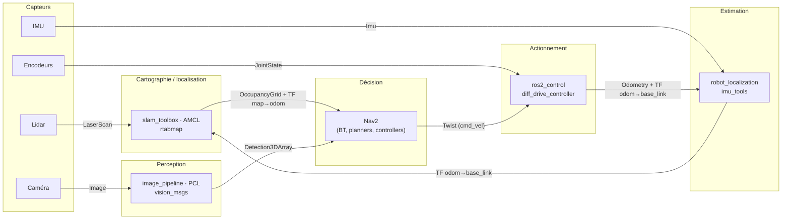

# 03 – L'écosystème ROS 2 pour les systèmes autonomes

## Objectifs pédagogiques

| Niveau (Bloom) | Objectif |
| --- | --- |
| Se souvenir | Associer chaque brique de la chaîne d'autonomie aux packages ROS 2 de référence. |
| Comprendre | Situer les interfaces standard (`sensor_msgs`, `nav_msgs`, TF) qui permettent de composer ces packages. |
| Évaluer | Choisir une pile logicielle adaptée à une plateforme (robot mobile, drone, manipulateur, véhicule) en tenant compte de la maturité et des contraintes embarquées. |

**Prérequis** : chapitres [01](01_concepts_et_cli.md) et [02](02_outils_rqt_bag_tf2_rviz2.md).

---

## 1. La chaîne d'autonomie et ses interfaces

L'intérêt de ROS 2 tient moins à ses packages qu'aux **interfaces standard** qui les rendent interchangeables : un SLAM qui consomme `sensor_msgs/msg/LaserScan` et publie `map → odom` fonctionne avec n'importe quel lidar dont le pilote respecte ces conventions.

| Interface | Package | Rôle |
| --- | --- | --- |
| `LaserScan`, `PointCloud2`, `Image`, `CameraInfo`, `Imu`, `NavSatFix` | `sensor_msgs` | Données capteurs |
| `Odometry`, `Path`, `OccupancyGrid` | `nav_msgs` | Estimation, trajectoires, cartes |
| `Twist(Stamped)`, `PoseStamped`, `TransformStamped` | `geometry_msgs` | Commandes, poses |
| `Detection2D/3DArray` | `vision_msgs` | Sorties de détecteurs |
| `/tf`, `/tf_static` | `tf2_msgs` | Arbre de repères |

> **Transition `Twist` → `TwistStamped`.** L'écosystème migre vers `TwistStamped` pour `cmd_vel`. Sous Jazzy, Nav2 publie encore `Twist` par défaut (paramètre `enable_stamped_cmd_vel: false`) ; ce n'est plus le cas depuis Kilted, où `TwistStamped` est devenu le défaut. Vérifiez toujours le type avec `ros2 topic info -v` avant de connecter deux briques : une incompatibilité de type empêche toute communication, sans message d'erreur explicite.

---

## 2. Panorama des packages

Légende de maturité :
- 🟢 **établi** : largement déployé, API stable ;
- 🟡 **récent ou en évolution** : moins de 3 ans, ou API qui change entre distributions ;
- 🔴 **recherche** : prototype ou problème ouvert.

Installation type : `sudo apt install ros-jazzy-<nom-du-package>`.

### 2.1 Description et simulation

| Package | Rôle | Maturité |
| --- | --- | --- |
| `urdf`, `xacro`, `robot_state_publisher`, `joint_state_publisher_gui` | Modèle cinématique du robot et publication des TF associées | 🟢 |
| **Gazebo Harmonic** + `ros_gz` (`ros_gz_sim`, `ros_gz_bridge`) | Simulateur physique de référence pour Jazzy ; pont entre topics Gazebo et ROS 2 | 🟢 (Gazebo Classic est en fin de vie depuis janvier 2025) |
| `webots_ros2` | Simulateur Webots, léger et multi-plateforme | 🟢 |
| NVIDIA Isaac Sim / Isaac ROS | Simulation photoréaliste, perception accélérée sur GPU | 🟡 Nécessite un GPU NVIDIA : hors du périmètre de ce cours |

### 2.2 Perception

| Package | Rôle | Maturité |
| --- | --- | --- |
| `image_pipeline` (`image_proc`, `camera_calibration`, `stereo_image_proc`) | Rectification, calibration, stéréo | 🟢 |
| `cv_bridge` (`vision_opencv`) | Conversion `sensor_msgs/Image` ↔ `numpy`/OpenCV | 🟢 |
| `perception_pcl`, `pcl_ros` | Traitement de nuages de points (filtrage, segmentation) | 🟢 |
| `apriltag_ros` | Détection de marqueurs fiduciaires et pose 6D | 🟢 |
| `depthimage_to_laserscan`, `pointcloud_to_laserscan` | Réduction 3D → 2D pour des algorithmes 2D | 🟢 |
| Détecteurs par apprentissage profond (YOLO, segmentation) → `vision_msgs` | Généralement encapsulés par l'utilisateur | 🟡 Pas de package de référence unique |

### 2.3 Estimation d'état, localisation et SLAM

| Package | Rôle | Maturité |
| --- | --- | --- |
| `robot_localization` | Fusion multi-capteurs par EKF/UKF (odométrie, IMU, GPS) ; publie `odom → base_link` et `map → odom` | 🟢 |
| `imu_tools` (`imu_filter_madgwick`, `imu_complementary_filter`) | Estimation d'attitude à partir d'une IMU | 🟢 |
| `nav2_amcl` | Localisation Monte-Carlo dans une carte connue | 🟢 |
| `slam_toolbox` | SLAM 2D par graphe de poses (lidar), modes synchrone, asynchrone et *lifelong* | 🟢 |
| `cartographer_ros` | SLAM 2D/3D par sous-cartes et fermeture de boucles | 🟡 Maintenance communautaire réduite |
| `rtabmap_ros` | SLAM visuel et RGB-D/lidar à base d'apparence | 🟢 |
| SLAM multi-robot, SLAM certifiable, cartes sémantiques | Thèmes de recherche actifs | 🔴 |

### 2.4 Planification et navigation

| Package | Rôle | Maturité |
| --- | --- | --- |
| **Nav2** | Pile de navigation complète : cartes de coût, planificateurs globaux (NavFn, Smac Hybrid-A\*, Smac Lattice), contrôleurs locaux (DWB, Regulated Pure Pursuit, MPPI), orchestration par arbres de comportement | 🟢 |
| `BehaviorTree.CPP` + Groot2 | Arbres de comportement (décision réactive), éditeur graphique | 🟢 |
| `nav2_mppi_controller` | Commande prédictive par échantillonnage (*Model Predictive Path Integral*) | 🟡 |
| Navigation apprise de bout en bout (RL, politiques visuomotrices) | Aujourd'hui hors des piles standard, intégrée par l'utilisateur | 🔴 |

### 2.5 Contrôle et actionnement

| Package | Rôle | Maturité |
| --- | --- | --- |
| `ros2_control` | Cadre temps réel d'abstraction matérielle (*hardware interfaces*) et de gestion de contrôleurs | 🟢 |
| `ros2_controllers` (`diff_drive_controller`, `joint_trajectory_controller`, `pid_controller`…) | Contrôleurs génériques prêts à l'emploi | 🟢 |
| `gz_ros2_control` | Branchement de `ros2_control` sur Gazebo (même code en simulation et sur le robot) | 🟢 |
| `MoveIt 2` | Planification de mouvement pour manipulateurs (OMPL, Pilz), cinématique inverse, évitement de collisions | 🟢 |

### 2.6 Plateformes spécifiques

| Package | Plateforme | Maturité |
| --- | --- | --- |
| **PX4** + `px4_msgs` via **uXRCE-DDS** | Drones : le contrôleur de vol publie et consomme directement des topics ROS 2 | 🟢 |
| ArduPilot (interface DDS native) | Drones, rovers, bateaux | 🟡 |
| Aerostack2 | Cadre multi-drones (comportements, missions) | 🟡 |
| **Autoware** | Pile complète de conduite autonome (véhicules routiers) | 🟢 Complexe, très gourmande en ressources |

### 2.7 Embarqué, temps réel et communication

| Package | Rôle | Maturité |
| --- | --- | --- |
| **micro-ROS** | ROS 2 sur microcontrôleurs (ESP32, STM32, RP2040) via un agent XRCE-DDS | 🟢 |
| `rmw_zenoh_cpp` | Middleware Zenoh : découverte routée, adapté au Wi-Fi et au multi-robot | 🟡 Binaires disponibles depuis Jazzy, Tier 1 depuis Kilted |
| `ros2_tracing` (LTTng) | Mesure de latences de bout en bout | 🟢 |
| `realtime_tools` | Publishers et tampons sans allocation pour des boucles temps réel | 🟢 |
| SROS2 | Authentification, chiffrement, contrôle d'accès DDS | 🟢 Rarement activé en pratique |
| `domain_bridge` | Pont entre domaines DDS (flotte multi-robots) | 🟡 |

### 2.8 Outils de données

| Outil | Rôle |
| --- | --- |
| `rosbag2` (MCAP) | Enregistrement et rejeu (voir le chapitre 02) |
| Foxglove | Visualisation web et analyse de bags MCAP |
| PlotJuggler | Tracés temporels avancés, en direct ou depuis un bag |

---

## 3. Compromis pour l'embarqué

| Choix | Coût calcul / mémoire | Commentaire |
| --- | --- | --- |
| `rclpy` vs `rclcpp` | Python : latence et gigue plus élevées, CPU accru (sérialisation, GIL) | Python pour le prototypage et les nœuds lents ; C++ pour les boucles de commande au-delà de ~100 Hz et pour la perception à haut débit. |
| Un nœud par processus vs **composition** (C++) | Plusieurs processus : copies et sérialisation entre nœuds | Les *component containers* chargent plusieurs nœuds dans un seul processus, avec communication **intra-processus sans copie**. |
| Nav2 complet sur carte ARM | Plusieurs cœurs, plusieurs centaines de Mo de RAM | Réduire la taille et la résolution des cartes de coût et la fréquence des contrôleurs ; MPPI est coûteux sans accélération vectorielle. |
| Enregistrement `ros2 bag -a` avec caméras | Débit disque de l'ordre de 100 Mo/s | Filtrer les topics, utiliser la compression ou les images compressées. |
| DDS sur Wi-Fi | Trafic de découverte multicast important | `ROS_AUTOMATIC_DISCOVERY_RANGE`, serveur de découverte Fast DDS, ou Zenoh. |

---

## 4. Exercices

**Exercice 1 – Pile logicielle.** Pour chacune des plateformes suivantes, proposez une pile de packages (perception, estimation, décision, actionnement) en justifiant vos choix et en identifiant les interfaces entre briques :
- (a) un robot différentiel d'intérieur avec lidar 2D ;
- (b) un quadrirotor PX4 avec caméra ;
- (c) une voiture miniature de course autonome avec lidar et IMU sur carte ARM.

**Exercice 2 – Exploration.** Installez `ros-jazzy-nav2-bringup` et `ros-jazzy-nav2-minimal-tb3-sim`, lancez la démonstration Nav2 en simulation (voir la documentation Nav2 *Getting Started*), puis observez avec `rqt_graph` et `view_frames` comment les briques de la section 1 sont connectées.

---

## 5. Questions d'évaluation

1. Pourquoi l'usage d'interfaces standard (`sensor_msgs/LaserScan`, TF) est-il plus déterminant pour l'interopérabilité que le choix de l'algorithme ?
2. Quel package publie `map → odom` dans une pile Nav2 utilisant AMCL ? Et avec `slam_toolbox` ?
3. Citez deux raisons de préférer `ros2_control` à un nœud qui écrit directement sur le bus moteur.
4. Pourquoi micro-ROS nécessite-t-il un *agent* sur un ordinateur compagnon ?
5. Identifiez une hypothèse implicite de Nav2 (en 2D) qui le rend inadapté tel quel à un drone.

## Références

- S. Macenski, F. Martín, R. White, J. Ginés Clavero, « The Marathon 2: A Navigation System », *IEEE/RSJ IROS*, 2020.
- S. Macenski, T. Moore, D. V. Lu, A. Merzlyakov, M. Ferguson, « From the desks of ROS maintainers: A survey of modern & capable mobile robotics algorithms in the robot operating system 2 », *Robotics and Autonomous Systems*, 168, 2023.
- S. Macenski, I. Jambrecic, « SLAM Toolbox: SLAM for the dynamic world », *Journal of Open Source Software*, 6(61), 2021.
- W. Hess, D. Kohler, H. Rapp, D. Andor, « Real-Time Loop Closure in 2D LIDAR SLAM », *IEEE ICRA*, 2016.
- M. Labbé, F. Michaud, « RTAB-Map as an open-source lidar and visual SLAM library for large-scale and long-term online operation », *Journal of Field Robotics*, 36(2), 2019.
- T. Moore, D. Stouch, « A Generalized Extended Kalman Filter Implementation for the Robot Operating System », *IAS-13*, 2014.
- S. Chitta, E. Marder-Eppstein, W. Meeussen et al., « ros_control: A generic and simple control framework for ROS », *Journal of Open Source Software*, 2(20), 2017 (ancêtre ROS 1 ; documentation de `ros2_control` : <https://control.ros.org/jazzy/>).
- G. Williams, A. Aldrich, E. Theodorou, « Model Predictive Path Integral Control using Covariance Variable Importance Sampling », arXiv:1509.01149, 2015.
