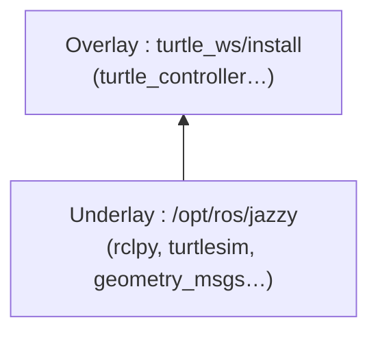

# 04 – Créer un workspace et un package

## Objectifs pédagogiques

À la fin de ce chapitre, vous saurez :

- expliquer comment un workspace s'appuie sur l'installation de ROS 2 (*underlay* et *overlay*) et dans quel ordre « sourcer » les environnements ;
- créer un workspace et un package Python (`ament_python`), puis le compiler avec `colcon` ;
- dire à quoi sert chaque fichier d'un package : `package.xml`, `setup.py`, `setup.cfg` et le dossier `resource/`.

**Prérequis** : Partie I.

---

## Sommaire

- [1. Notions](#1-notions)
- [2. Créer le workspace](#2-créer-le-workspace)
- [3. Créer un package](#3-créer-un-package)
- [4. Anatomie d'un package `ament_python`](#4-anatomie-dun-package-ament_python)
- [5. Compiler et sourcer](#5-compiler-et-sourcer)
- [6. Gérer les dépendances avec rosdep](#6-gérer-les-dépendances-avec-rosdep)
- [7. Exercice fil rouge](#7-exercice-fil-rouge)
- [8. Questions d'évaluation](#8-questions-dévaluation)

---

## 1. Notions

| Terme | Définition |
| --- | --- |
| **Package** | Unité d'organisation, de compilation et de distribution : code, interfaces, launch files, configuration, et un manifeste `package.xml`. |
| **Workspace** | Répertoire contenant un dossier `src/` avec un ou plusieurs packages, compilés ensemble. |
| **colcon** | Outil de compilation qui ordonne les packages selon leurs dépendances et appelle le *build type* de chacun. |
| **ament** | Système de build de ROS 2 : `ament_cmake` (C++ et interfaces) ou `ament_python` (Python pur). |
| **Underlay / overlay** | L'installation de ROS (`/opt/ros/jazzy`) est l'*underlay*. Votre workspace est un *overlay* qui s'y superpose : un package présent dans l'overlay masque celui de même nom dans l'underlay. |



Le sourçage est **cumulatif et ordonné** : on source d'abord l'underlay, puis l'overlay.

```bash
source /opt/ros/jazzy/setup.bash             # en général déjà présent dans ~/.bashrc de l'image
source <workspace>/install/setup.bash        # après chaque compilation qui ajoute un package ou un exécutable
```

> **Bonne pratique.** Compilez depuis un terminal où **seul l'underlay** est sourcé, et utilisez un autre terminal pour exécuter. Compiler un workspace dont l'overlay est déjà sourcé fonctionne dans la plupart des cas, mais peut produire des erreurs difficiles à comprendre lorsqu'on supprime ou renomme des packages.

---

## 2. Créer le workspace

> ⚠️ **Persistance dans le conteneur.** Tout ce qui est créé dans le dossier personnel du conteneur (`~`) est **perdu** lors d'un *Rebuild Container*. Créez le workspace **dans le dossier du dépôt**, monté depuis la machine hôte (en général `/workspaces/ros2_tutorial`). Le `.gitignore` du dépôt ignore déjà `turtle_ws/`.

```bash
cd /workspaces/ros2_tutorial          # vérifiez avec : pwd dans le terminal VS Code
mkdir -p turtle_ws/src
cd turtle_ws
colcon build                          # workspace vide : crée build/, install/, log/
```

Structure obtenue :

```text
turtle_ws/
├── build/     # fichiers intermédiaires (ne jamais modifier)
├── install/   # résultat installé + scripts setup.bash  ← ce qu'on source
├── log/       # journaux de colcon
└── src/       # vos packages  ← le seul dossier à versionner
```

### Autocomplétion et sourçage automatique

```bash
# Autocomplétion de colcon (si elle n'est pas déjà active dans l'image)
echo "source /usr/share/colcon_argcomplete/hook/colcon-argcomplete.bash" >> ~/.bashrc

# Sourcer l'overlay uniquement s'il existe (évite une erreur avant la première compilation)
echo '[ -f /workspaces/ros2_tutorial/turtle_ws/install/setup.bash ] && source /workspaces/ros2_tutorial/turtle_ws/install/setup.bash' >> ~/.bashrc
```

> Le `~/.bashrc` du conteneur est lui aussi réinitialisé lors d'un *Rebuild*. Pour rendre ce réglage permanent, ajoutez ces lignes dans le `Dockerfile` ou dans le champ `postCreateCommand` de `devcontainer.json`.

---

## 3. Créer un package

```bash
cd /workspaces/ros2_tutorial/turtle_ws/src

# Package Python
ros2 pkg create turtle_controller --build-type ament_python \
  --dependencies rclpy geometry_msgs turtlesim \
  --license Apache-2.0 \
  --description "Contrôleurs pour turtlesim"
```

Options utiles de `ros2 pkg create` :

| Option | Effet |
| --- | --- |
| `--build-type ament_python` ou `ament_cmake` | Python pur, ou C++ et interfaces |
| `--dependencies a b c` | Remplit `package.xml` (et `CMakeLists.txt` pour `ament_cmake`) |
| `--node-name mon_noeud` | Génère un nœud minimal et l'enregistre comme exécutable |
| `--license`, `--maintainer-name`, `--maintainer-email` | Métadonnées |

### Quel *build type* choisir ?

| | `ament_python` | `ament_cmake` |
| --- | --- | --- |
| Langage | Python | C++ (Python possible via `ament_cmake_python`) |
| Interfaces `.msg` / `.srv` / `.action` | ❌ impossible | ✅ **obligatoire** |
| Compilation | Rapide (copie ou lien) | Compilation native |
| Usage typique | Prototypage, nœuds de haut niveau, scripts | Pilotes, boucles de commande rapides, perception, composants |

> On en déduit une règle d'architecture : **un package dédié aux interfaces** (`ament_cmake`), séparé des packages de code. Ce point est traité au chapitre 09.

---

## 4. Anatomie d'un package `ament_python`

```text
turtle_controller/
├── package.xml              # manifeste : nom, version, dépendances (format 3)
├── setup.py                 # installation Python + déclaration des exécutables
├── setup.cfg                # indique où installer les scripts (lib/<package>)
├── resource/
│   └── turtle_controller    # fichier marqueur vide (index ament) : ne pas supprimer
├── turtle_controller/       # module Python : vos nœuds ici
│   └── __init__.py
└── test/                    # tests de style (flake8, pep257) et de copyright
```

### `package.xml`

```xml
<?xml version="1.0"?>
<package format="3">
  <name>turtle_controller</name>
  <version>0.0.1</version>
  <description>Contrôleurs pour turtlesim</description>
  <maintainer email="etudiant@example.com">Étudiant</maintainer>
  <license>Apache-2.0</license>

  <depend>rclpy</depend>
  <depend>geometry_msgs</depend>
  <depend>turtlesim</depend>

  <test_depend>ament_flake8</test_depend>
  <test_depend>ament_pep257</test_depend>
  <test_depend>python3-pytest</test_depend>

  <export>
    <build_type>ament_python</build_type>
  </export>
</package>
```

| Balise | Signification |
| --- | --- |
| `<depend>` | Dépendance à la compilation **et** à l'exécution (le cas le plus courant) |
| `<build_depend>` / `<exec_depend>` | Dépendance à la compilation seulement / à l'exécution seulement |
| `<buildtool_depend>` | Outil de build (`ament_cmake`, `rosidl_default_generators`) |
| `<test_depend>` | Dépendance nécessaire uniquement aux tests |

> Pour un package Python, oublier une dépendance dans `package.xml` **ne bloque pas la compilation** : l'erreur n'apparaît qu'à l'exécution sur une autre machine, ou lors du passage de `rosdep`. Déclarez systématiquement chaque `import`.

### `setup.py`

```python
from setuptools import find_packages, setup

package_name = 'turtle_controller'

setup(
    name=package_name,
    version='0.0.1',
    packages=find_packages(exclude=['test']),
    data_files=[
        ('share/ament_index/resource_index/packages', ['resource/' + package_name]),
        ('share/' + package_name, ['package.xml']),
        # Plus tard (chapitres 07–08) : launch files et fichiers YAML
        # ('share/' + package_name + '/launch', glob('launch/*.launch.py')),
        # ('share/' + package_name + '/config', glob('config/*.yaml')),
    ],
    install_requires=['setuptools'],
    zip_safe=True,
    maintainer='Étudiant',
    maintainer_email='etudiant@example.com',
    description='Contrôleurs pour turtlesim',
    license='Apache-2.0',
    tests_require=['pytest'],
    entry_points={
        'console_scripts': [
            # <nom_exécutable> = <module>.<fichier>:<fonction>
            'pid_regulator = turtle_controller.pid_regulator:main',
        ],
    },
)
```

`entry_points` fait le lien entre le nom passé à `ros2 run <package> <exécutable>` et la fonction Python à appeler.

---

## 5. Compiler et sourcer

```bash
cd /workspaces/ros2_tutorial/turtle_ws        # toujours à la RACINE du workspace, jamais dans src/
colcon build --symlink-install
source install/setup.bash
```

| Option de `colcon build` | Effet |
| --- | --- |
| `--symlink-install` | Installe des **liens** vers les sources plutôt que des copies |
| `--packages-select pkg1 pkg2` | Ne compile que ces packages |
| `--packages-up-to pkg` | Compile `pkg` et ses dépendances |
| `--event-handlers console_direct+` | Affiche la sortie complète du build (débogage) |
| `--cmake-args -DCMAKE_BUILD_TYPE=Release` | Compilation optimisée (packages C++) |

### Quand faut-il recompiler ?

| Modification | Avec `--symlink-install` | Sans |
| --- | --- | --- |
| Code d'un fichier `.py` existant | ❌ Non : relancer le nœud suffit | ✅ Oui |
| Nouvel exécutable dans `entry_points`, ou modification de `setup.py` | ✅ Oui, puis re-sourcer | ✅ Oui, puis re-sourcer |
| Nouveau fichier launch ou YAML déclaré dans `data_files` | ✅ Oui (la première fois) | ✅ Oui |
| Code C++ | ✅ Toujours | ✅ Toujours |
| Nouveau package | ✅ Oui, puis re-sourcer | ✅ Oui, puis re-sourcer |

En cas de comportement incompréhensible, repartez d'un workspace propre :
```bash
rm -rf build install log && colcon build --symlink-install
```

---

## 6. Gérer les dépendances avec rosdep

`rosdep` installe automatiquement les dépendances système déclarées dans les `package.xml` de `src/` :

```bash
sudo rosdep init        # une seule fois par machine (peut déjà être fait dans l'image)
rosdep update
cd /workspaces/ros2_tutorial/turtle_ws
rosdep install --from-paths src --ignore-src -r -y
```

C'est la commande à lancer après avoir cloné un workspace tiers.

---

## 7. Exercice fil rouge

**Objectif** : préparer le package qui accueillera le nœud `pid_regulator` tout au long de la Partie II.

1. Créez le workspace `turtle_ws` dans le dossier du dépôt.
2. Créez le package `ament_python` `turtle_controller`, qui dépend de `rclpy`, `geometry_msgs` et `turtlesim`.
3. Compilez avec `--symlink-install`, sourcez, puis vérifiez :
   ```bash
   ros2 pkg list | grep turtle_controller
   ros2 pkg prefix turtle_controller
   ```
4. Configurez le sourçage automatique de l'overlay.
5. *(Approfondissement)* Créez un second package `turtle_controller_cpp` de type `ament_cmake` avec l'option `--node-name hello`. Compilez-le, exécutez-le, puis comparez la structure des deux packages et le contenu de `install/`.

**Critère de validation** : `ros2 pkg prefix turtle_controller` renvoie un chemin sous `turtle_ws/install`.

---

## 8. Questions d'évaluation

1. Un package `turtlesim` modifié est placé dans `turtle_ws/src`. Lequel est utilisé par `ros2 run turtlesim turtlesim_node` après sourçage de l'overlay ? Pourquoi ?
2. Pourquoi ne faut-il jamais lancer `colcon build` depuis le dossier `src/` ?
3. Vous ajoutez une seconde entrée dans `entry_points` mais `ros2 run` ne la trouve pas, alors que vous utilisez `--symlink-install`. Expliquez.
4. Pourquoi un package contenant des fichiers `.msg` doit-il être de type `ament_cmake` ?
5. Quelle différence pratique y a-t-il entre `<depend>` et `<exec_depend>` ?
