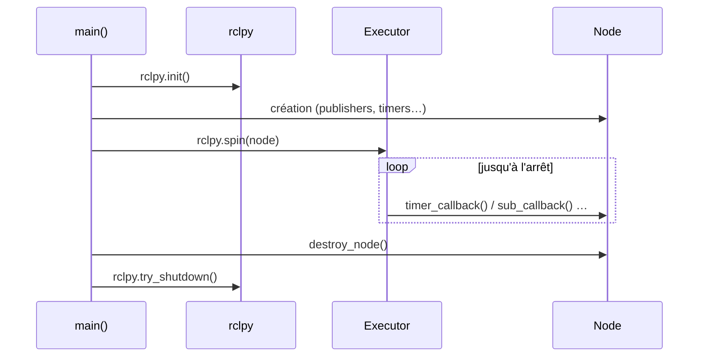

# 05 – Écrire un nœud ROS 2 en Python

## Objectifs pédagogiques

| Niveau (Bloom) | Objectif |
| --- | --- |
| Comprendre | Décrire le cycle de vie d'un programme `rclpy` (init → création → spin → arrêt). |
| Comprendre | Expliquer le rôle de l'executor et des callback groups. |
| Appliquer | Écrire un nœud orienté objet avec timer, logging et arrêt propre, puis l'enregistrer comme exécutable. |
| Analyser | Identifier pourquoi un callback bloquant fige un nœud. |

**Prérequis** : [04 – Workspace et package](04_workspace_et_package.md).

---

## Sommaire

- [1. Nœud, processus, executor](#1-nœud-processus-executor)
- [2. Nœud minimal](#2-nœud-minimal)
- [3. Timers : exécuter périodiquement](#3-timers--exécuter-périodiquement)
- [4. Logging](#4-logging)
- [5. Executors et callback groups](#5-executors-et-callback-groups)
- [6. Nommage, namespaces et arguments ROS](#6-nommage-namespaces-et-arguments-ros)
- [7. Bonnes pratiques](#7-bonnes-pratiques)
- [8. Exercice fil rouge : `pid_regulator`](#8-exercice-fil-rouge--pid_regulator)
- [9. Questions d'évaluation](#9-questions-dévaluation)

---

## 1. Nœud, processus, executor

- Un **nœud** est une entité logique du graphe, avec un nom unique, qui possède des publishers, des subscribers, des services, des actions, des paramètres et des timers.
- Un **processus** peut contenir un ou plusieurs nœuds. En Python, on écrit en général un nœud par exécutable. En C++, la *composition* permet d'en charger plusieurs dans un même processus (chapitre 03 de la Partie I, section 3).
- Un **executor** est la boucle d'événements : il attend qu'un événement se produise (message reçu, échéance de timer, requête de service…) et **appelle le callback correspondant**.

Le code d'un nœud ROS 2 est donc **événementiel** : on ne programme pas de boucle `while True`. On déclare des callbacks, et l'executor les déclenche.



---

## 2. Nœud minimal

Fichier `turtle_controller/turtle_controller/hello_node.py` :

```python
import rclpy
from rclpy.executors import ExternalShutdownException
from rclpy.node import Node


class HelloNode(Node):
    """Nœud minimal : affiche un message au démarrage."""

    def __init__(self) -> None:
        super().__init__('hello_node')          # nom du nœud dans le graphe
        self.get_logger().info('Nœud démarré.')


def main(args=None) -> None:
    rclpy.init(args=args)                       # initialise le contexte et analyse --ros-args
    node = HelloNode()
    try:
        rclpy.spin(node)                        # bloque et traite les callbacks
    except (KeyboardInterrupt, ExternalShutdownException):
        pass                                    # Ctrl+C ou arrêt externe : sortie propre
    finally:
        node.destroy_node()
        rclpy.try_shutdown()                    # ne lève pas d'erreur si déjà arrêté


if __name__ == '__main__':
    main()
```

Déclaration dans `setup.py` :

```python
entry_points={
    'console_scripts': [
        'hello_node = turtle_controller.hello_node:main',
    ],
},
```

```bash
cd /workspaces/ros2_tutorial/turtle_ws
colcon build --symlink-install --packages-select turtle_controller
source install/setup.bash
ros2 run turtle_controller hello_node
```

> Sans le bloc `try/except`, un Ctrl+C affiche une longue trace `KeyboardInterrupt` et peut laisser des ressources non libérées. Ce patron est à réutiliser dans **tous** vos nœuds.

---

## 3. Timers : exécuter périodiquement

Un timer remplace la boucle `while` munie d'un `sleep` : l'executor appelle le callback à la période demandée, sans bloquer le traitement des autres événements.

```python
import rclpy
from rclpy.executors import ExternalShutdownException
from rclpy.node import Node


class CounterNode(Node):
    def __init__(self) -> None:
        super().__init__('counter_node')
        self.counter = 0
        self.period = 0.5                                          # s
        self.timer = self.create_timer(self.period, self.on_timer)
        self.t_prev = self.get_clock().now()

    def on_timer(self) -> None:
        now = self.get_clock().now()
        dt = (now - self.t_prev).nanoseconds * 1e-9                # dt réellement écoulé
        self.t_prev = now
        self.counter += 1
        self.get_logger().info(f'tick {self.counter}  (dt = {dt:.4f} s)')


def main(args=None) -> None:
    rclpy.init(args=args)
    node = CounterNode()
    try:
        rclpy.spin(node)
    except (KeyboardInterrupt, ExternalShutdownException):
        pass
    finally:
        node.destroy_node()
        rclpy.try_shutdown()
```

**Horloges.** Utilisez `self.get_clock().now()` plutôt que `time.time()`. L'horloge du nœud respecte `use_sim_time`, ce qui permet au même code de fonctionner en simulation et lors du rejeu d'un bag (voir le chapitre 02).

**Période nominale et période réelle.** En Python, la gigue sur `dt` atteint couramment la milliseconde, voire plus sous charge. Pour un correcteur discret (intégrale, dérivée), **utilisez le `dt` mesuré**, pas la période nominale.

---

## 4. Logging

```python
log = self.get_logger()
log.debug('détail de mise au point')
log.info('fonctionnement normal')
log.warn('situation anormale mais récupérable')
log.error('échec d\'une opération')
log.fatal('erreur irrécupérable')

log.info('affiché une seule fois', once=True)
log.warn('au plus une fois par seconde', throttle_duration_sec=1.0)
```

```bash
ros2 run turtle_controller counter_node --ros-args --log-level debug
ros2 run turtle_controller counter_node --ros-args --log-level counter_node:=debug   # par nœud
```

Les logs sont aussi publiés sur le topic `/rosout`, que l'on peut consulter avec `rqt_console` ou enregistrer dans un bag.

> Évitez `print()` : sa sortie n'est ni horodatée, ni filtrable, ni publiée sur `/rosout`.

---

## 5. Executors et callback groups

### 5.1 Le piège du callback bloquant

`rclpy.spin(node)` utilise un **`SingleThreadedExecutor`** : les callbacks s'exécutent **l'un après l'autre**, dans un seul thread. Un callback qui bloque (par exemple `time.sleep(5)`, un calcul lourd, ou l'attente synchrone d'une réponse de service) **gèle tout le nœud** : les messages s'accumulent puis sont perdus, et les timers prennent du retard.

```python
def on_timer(self):
    time.sleep(2.0)   # ❌ pendant 2 s, plus aucun autre callback n'est traité
```

### 5.2 Exécution concurrente

```python
from rclpy.callback_groups import MutuallyExclusiveCallbackGroup, ReentrantCallbackGroup
from rclpy.executors import MultiThreadedExecutor

class MyNode(Node):
    def __init__(self):
        super().__init__('my_node')
        self.fast_group = MutuallyExclusiveCallbackGroup()
        self.slow_group = MutuallyExclusiveCallbackGroup()
        self.create_timer(0.01, self.control_loop, callback_group=self.fast_group)
        self.create_timer(1.00, self.slow_task,    callback_group=self.slow_group)

executor = MultiThreadedExecutor(num_threads=2)
executor.add_node(node)
executor.spin()
```

| Callback group | Règle |
| --- | --- |
| `MutuallyExclusiveCallbackGroup` (défaut) | Les callbacks **d'un même groupe** ne s'exécutent jamais en parallèle. |
| `ReentrantCallbackGroup` | Les callbacks du groupe peuvent s'exécuter en parallèle, y compris plusieurs instances du même callback. |

> **Limite en Python.** À cause du GIL, `MultiThreadedExecutor` apporte de la **concurrence** (un callback qui attend n'en bloque pas d'autres) mais pas de **parallélisme** de calcul. Pour un calcul lourd, utilisez du C++, un processus séparé, ou une bibliothèque qui relâche le GIL (NumPy, PyTorch). Ces notions deviennent indispensables pour les services et les actions (chapitres 10 et 11).

---

## 6. Nommage, namespaces et arguments ROS

Rappel de la Partie I : tout nom peut être modifié au lancement sans toucher au code.

```bash
ros2 run turtle_controller hello_node --ros-args \
  -r __node:=hello_robot1 \
  -r __ns:=/robot1 \
  -p ma_valeur:=3.0 \
  --log-level info
```

| Nom déclaré dans le code | Namespace `/robot1` | Nom résolu |
| --- | --- | --- |
| `'cmd_vel'` (relatif) | ✅ | `/robot1/cmd_vel` |
| `'/cmd_vel'` (absolu) | ignoré | `/cmd_vel` |
| `'~/status'` (privé) | ✅ | `/robot1/hello_robot1/status` |

**Règle** : dans le code, utilisez des noms **relatifs** et laissez le lancement (launch file, chapitre 08) fixer le namespace.

---

## 7. Bonnes pratiques

1. **Un nœud = une responsabilité** (pilote, estimateur, contrôleur…), avec un nom explicite en `snake_case`.
2. **Toute la configuration dans `__init__`** (publishers, subscribers, timers, paramètres) ; la logique dans des méthodes courtes.
3. **Pas de boucle bloquante** : timers et callbacks uniquement. Les callbacks doivent rester **courts** par rapport à la période la plus rapide du nœud.
4. **Arrêt propre** : utilisez le patron `try / except (KeyboardInterrupt, ExternalShutdownException) / finally`. Pour un actionneur, publiez une commande nulle avant de quitter.
5. **Horloge ROS** (`get_clock()`) et `dt` mesuré, jamais `time.time()`.
6. **Logs** plutôt que `print`, en utilisant `throttle_duration_sec` dans les callbacks rapides.
7. **Noms relatifs** pour les topics et services.
8. **Annotations de type et docstrings** : les tests `ament_flake8` et `ament_pep257` générés avec le package les vérifient (`colcon test`).

---

## 8. Exercice fil rouge : `pid_regulator`

**Objectif** : créer le squelette du nœud qui sera complété dans les chapitres suivants (topics, paramètres, service, action).

**Spécification**

1. Fichier `turtle_controller/turtle_controller/pid_regulator.py`, classe `PidRegulator(Node)`, nom de nœud `pid_regulator`.
2. Au démarrage, afficher : `Node pid_regulator has been created successfully!`
3. Un timer à **50 Hz** appelle une méthode `control_loop()`. Pour l'instant, elle mesure le `dt` réel et l'affiche **au plus une fois par seconde** (`throttle_duration_sec`).
4. Arrêt propre sur Ctrl+C, sans trace d'erreur.
5. Enregistrer l'exécutable `pid_regulator` dans `setup.py`, compiler et lancer :
   ```bash
   ros2 run turtle_controller pid_regulator
   ```

**Critères de validation**

- `ros2 node list` affiche `/pid_regulator`.
- Le `dt` moyen affiché est proche de 0,020 s.
- `ros2 run turtle_controller pid_regulator --ros-args -r __ns:=/robot1` crée le nœud `/robot1/pid_regulator`.
- Ctrl+C termine le programme sans afficher de *traceback*.

**Approfondissement** : ajoutez temporairement `time.sleep(0.05)` dans `control_loop()`. Mesurez la fréquence effective, puis expliquez le résultat à l'aide de la section 5.

---

## 9. Questions d'évaluation

1. Pourquoi un nœud ROS 2 ne doit-il pas contenir de boucle `while rclpy.ok(): ... time.sleep(...)` dans son constructeur ?
2. Que se passe-t-il pour les messages d'un subscriber si un callback de timer du même nœud dure plus longtemps que la période de publication du topic ?
3. Dans un correcteur PID discret, pourquoi utiliser le `dt` mesuré plutôt que la période nominale du timer ? Quel terme est le plus sensible à la gigue ?
4. `MultiThreadedExecutor` permet-il d'accélérer un calcul NumPy intensif en Python ? Et un calcul en Python pur ? Justifiez.
5. Un nœud déclare un publisher sur `'/cmd_vel'` et il est lancé dans le namespace `/robot2`. Sur quel topic publie-t-il ? Quel problème cela pose-t-il pour une flotte de robots ?
