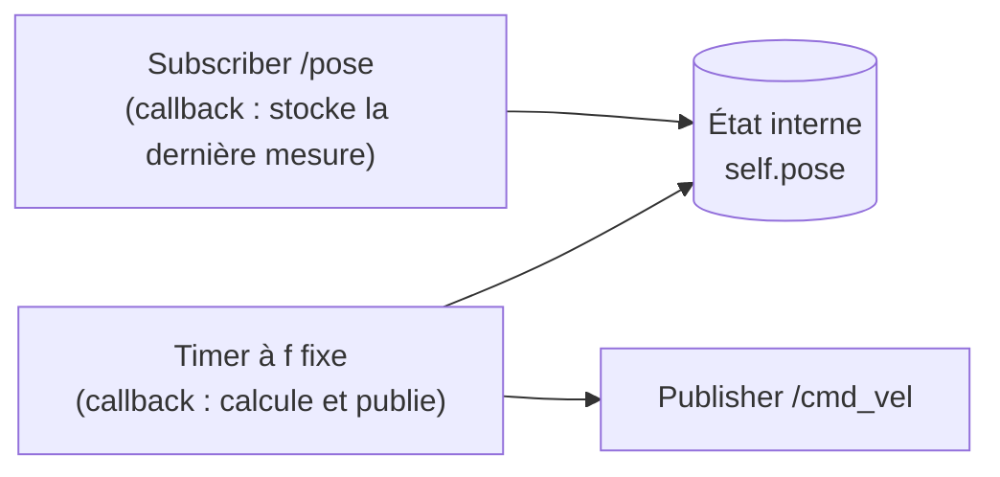

# 06 – Topics et qualité de service (QoS)

## Objectifs pédagogiques

À la fin de ce chapitre, vous saurez :

- expliquer les réglages de QoS (fiabilité, durabilité, historique) et savoir quand un publisher et un subscriber sont compatibles ;
- écrire un publisher et un subscriber en `rclpy`, avec une QoS choisie explicitement ;
- écrire une boucle de commande complète : lire une mesure, calculer la commande dans un timer, l'envoyer au robot ;
- trouver avec la commande `ros2` pourquoi deux nœuds ne communiquent pas (nom, type ou QoS) ;
- écrire un régulateur qui amène la tortue de turtlesim à une position cible.

**Prérequis** : [05 – Nœuds](05_noeuds.md) (squelette de `pid_regulator`).

---

## Sommaire

- [1. Rappels](#1-rappels)
- [2. Publisher](#2-publisher)
- [3. Subscriber](#3-subscriber)
- [4. Qualité de service (QoS)](#4-qualité-de-service-qos)
- [5. Patron « mesure → commande »](#5-patron--mesure--commande-)
- [6. Bonnes pratiques](#6-bonnes-pratiques)
- [7. Exercice fil rouge : régulateur de position pour turtlesim](#7-exercice-fil-rouge--régulateur-de-position-pour-turtlesim)
- [8. Questions d'évaluation](#8-questions-dévaluation)

---

## 1. Rappels

Un topic est un canal **nommé** et **typé**, de modèle publication / abonnement (voir la Partie I, chapitre 01) :
- **asynchrone** : le publisher n'attend aucun subscriber ;
- **N → M** : plusieurs publishers et plusieurs subscribers peuvent partager un même topic ;
- **typé** : tous les messages d'un topic ont le même type (`geometry_msgs/msg/Twist`, `turtlesim/msg/Pose`…).

Trois conditions sont nécessaires pour que deux nœuds communiquent : **même nom résolu**, **même type** et **QoS compatibles**.

---

## 2. Publisher

```python
import rclpy
from rclpy.executors import ExternalShutdownException
from rclpy.node import Node
from std_msgs.msg import String


class Talker(Node):
    def __init__(self) -> None:
        super().__init__('talker')
        # (type, nom, QoS) ; un entier = profondeur d'historique avec les QoS par défaut
        self.pub = self.create_publisher(String, 'chatter', 10)
        self.count = 0
        self.timer = self.create_timer(0.5, self.on_timer)

    def on_timer(self) -> None:
        msg = String()
        msg.data = f'Bonjour ROS 2 #{self.count}'
        self.pub.publish(msg)
        self.count += 1
        self.get_logger().info(f'Publié : {msg.data}', throttle_duration_sec=2.0)


def main(args=None) -> None:
    rclpy.init(args=args)
    node = Talker()
    try:
        rclpy.spin(node)
    except (KeyboardInterrupt, ExternalShutdownException):
        pass
    finally:
        node.destroy_node()
        rclpy.try_shutdown()
```

`create_publisher(msg_type, topic, qos_profile)` :

| Argument | Rôle |
| --- | --- |
| `msg_type` | Classe Python du message, importée depuis `<package>.msg` |
| `topic` | Nom **relatif** de préférence (`'chatter'`, `'turtle1/cmd_vel'`), résolu dans le namespace du nœud |
| `qos_profile` | `QoSProfile` complet, ou un entier (profondeur) avec les autres politiques par défaut |

> Le nom d'un topic **n'a pas à être unique** : c'est précisément le nom partagé qui relie publishers et subscribers. Il doit être **explicite** et cohérent avec les conventions (`cmd_vel`, `scan`, `odom`, `imu/data`…).

---

## 3. Subscriber

```python
from std_msgs.msg import String


class Listener(Node):
    def __init__(self) -> None:
        super().__init__('listener')
        self.sub = self.create_subscription(String, 'chatter', self.on_msg, 10)

    def on_msg(self, msg: String) -> None:
        self.get_logger().info(f'Reçu : {msg.data}')
```

`create_subscription(msg_type, topic, callback, qos_profile)` : le callback reçoit **un seul argument**, le message. Il doit rester **court** : stocker la donnée, éventuellement la prétraiter, et rendre la main.

> **Attention à la référence.** Conservez l'objet renvoyé (`self.sub = ...`). Sans référence, l'abonnement peut être détruit par le ramasse-miettes Python et le callback ne sera jamais appelé.

---

## 4. Qualité de service (QoS)

### 4.1 Politiques

| Politique | Valeurs | Signification |
| --- | --- | --- |
| **History** | `KEEP_LAST` (avec `depth`), `KEEP_ALL` | Taille de la file d'attente côté émetteur et côté récepteur |
| **Reliability** | `RELIABLE`, `BEST_EFFORT` | Retransmission des messages perdus, ou non |
| **Durability** | `VOLATILE`, `TRANSIENT_LOCAL` | Un subscriber arrivé tard reçoit-il les derniers messages publiés ? |
| **Deadline** | durée | Période maximale attendue entre deux messages |
| **Lifespan** | durée | Âge au-delà duquel un message est jeté |
| **Liveliness** | `AUTOMATIC`, `MANUAL_BY_TOPIC` + *lease duration* | Détection de la disparition d'un publisher |

### 4.2 Profils prédéfinis

| Profil | Reliability | Durability | Depth | Usage |
| --- | --- | --- | --- | --- |
| Par défaut (entier `10`) | RELIABLE | VOLATILE | 10 | Commandes, états |
| `qos_profile_sensor_data` | BEST_EFFORT | VOLATILE | 5 | Capteurs à haut débit : la donnée fraîche prime sur la complète |
| *Latched* (à construire) | RELIABLE | TRANSIENT_LOCAL | 1 | Données publiées rarement : carte, `/tf_static`, `robot_description` |

```python
from rclpy.qos import (QoSProfile, ReliabilityPolicy, DurabilityPolicy,
                       HistoryPolicy, qos_profile_sensor_data)

latched = QoSProfile(
    depth=1,
    history=HistoryPolicy.KEEP_LAST,
    reliability=ReliabilityPolicy.RELIABLE,
    durability=DurabilityPolicy.TRANSIENT_LOCAL,
)
self.map_pub = self.create_publisher(OccupancyGrid, 'map', latched)
self.scan_sub = self.create_subscription(LaserScan, 'scan', self.on_scan, qos_profile_sensor_data)
```

### 4.3 Compatibilité : le modèle « offert / demandé »

Le publisher **offre** une qualité, le subscriber en **demande** une. La connexion s'établit seulement si l'offre est **au moins aussi forte** que la demande.

| Publisher (offre) | Subscriber (demande) | Connexion |
| --- | --- | --- |
| RELIABLE | RELIABLE ou BEST_EFFORT | ✅ |
| BEST_EFFORT | BEST_EFFORT | ✅ |
| BEST_EFFORT | RELIABLE | ❌ |
| TRANSIENT_LOCAL | TRANSIENT_LOCAL ou VOLATILE | ✅ |
| VOLATILE | TRANSIENT_LOCAL | ❌ |

En cas d'incompatibilité, **aucun message ne passe**. ROS 2 se contente d'écrire un avertissement dans les logs (*« offering incompatible QoS »*), facile à manquer. Diagnostic :

```bash
ros2 topic info /scan -v          # QoS de chaque publisher et de chaque subscriber
ros2 topic echo /scan --qos-reliability best_effort   # écouter un capteur BEST_EFFORT depuis la CLI
```

### 4.4 Choisir `depth`

- **Commande de bas niveau** (`cmd_vel` à 50 Hz) : une file courte (1 à 10). Un vieux message de commande n'a pas de valeur.
- **Événements** à ne pas perdre (détections, transitions d'état) : RELIABLE avec une file plus longue.
- **Coût mémoire** : $\text{depth} \times \text{taille du message}$, par publisher **et** par subscriber. Pour un nuage de points de 2 Mo, `depth=10` représente déjà 20 Mo de chaque côté, ce qui est significatif sur une carte embarquée.

---

## 5. Patron « mesure → commande »

Une boucle de commande ROS 2 sépare trois rôles :



- Le **callback de mesure** se contente de mémoriser la dernière valeur, avec son horodatage.
- Le **timer** fixe la fréquence de commande, indépendamment de la fréquence du capteur. Il calcule la commande à partir de la dernière mesure disponible.
- Si aucune mesure n'est arrivée (ou si elle est trop ancienne), le timer publie une **commande nulle** : c'est le comportement sûr par défaut.

Commander directement dans le callback de mesure est possible (cadence imposée par le capteur), mais couple la fréquence de commande à celle du capteur et complique la gestion d'une mesure absente.

---

## 6. Bonnes pratiques

1. **Noms relatifs** (`turtle1/cmd_vel`) pour que le namespace s'applique (chapitre 08).
2. **Types standard** (`geometry_msgs`, `sensor_msgs`, `nav_msgs`) avant de créer un message personnalisé.
3. **QoS explicite** et adaptée au flux : `qos_profile_sensor_data` pour les capteurs, RELIABLE pour les commandes, TRANSIENT_LOCAL pour les données rares.
4. **Callbacks courts** ; le calcul se fait dans le timer.
5. **Commande nulle** à l'arrêt du nœud et en cas de mesure périmée.
6. **Vérifier à la CLI** (`ros2 topic echo`, `hz`, `info -v`) avant de connecter un nouveau nœud.

## 7. Exercice fil rouge : régulateur de position pour Turtlesim

### 7.1. Objectif

Compléter le nœud `pid_regulator` du chapitre 05 afin de permettre à la tortue de rejoindre automatiquement une **position cible** $(x_d,y_d)$.

La position cible est définie directement dans le code. Elle pourra ensuite être configurée à l'aide d'un paramètre ROS 2, d'un service ou d'une action.

Le contrôleur doit :

1. Calculer la distance entre la tortue et sa cible.
2. Déterminer la direction à suivre.
3. Ajuster les vitesses linéaire et angulaire.
4. Arrêter la tortue lorsqu'elle atteint la position souhaitée.

### 7.2. Modèle cinématique

La tortue est modélisée comme un **robot mobile de type unicycle**, dont le mouvement est décrit par :

$$
\boxed{
\begin{cases}
\dot{x} = v\cos(\theta)\\
\dot{y} = v\sin(\theta)\\
\dot{\theta} = \omega
\end{cases}
}
$$

Avec :

- $(x,y)$ : position actuelle.
- $\theta$ : orientation actuelle.
- $v$ : vitesse linéaire.
- $\omega$ : vitesse angulaire.

Les commandes sont publiées sur `/turtle1/cmd_vel` avec le message `geometry_msgs/msg/Twist` :

- `linear.x` : vitesse linéaire $v$.
- `angular.z` : vitesse angulaire $\omega$.

### 7.3. Calcul des erreurs

**1. Distance à la cible**

$$
\boxed{
\rho = \sqrt{(x_d-x)^2+(y_d-y)^2}
}
$$

**2. Orientation vers la cible**

$$
\boxed{
\theta_c = \operatorname{atan2}(y_d-y,x_d-x)
}
$$

**3. Erreur d'orientation vers la cible**

$$
\boxed{
\alpha = \operatorname{wrap}(\theta_c-\theta)
}
$$

La fonction `wrap` permet de ramener un angle dans l'intervalle $[-\pi,\pi]$ :

```python
def wrap(angle):
    return math.atan2(math.sin(angle), math.cos(angle))
```

### 7.4. Loi de commande proportionnelle

Pour atteindre la position cible, nous utilisons **deux régulateurs proportionnels** : un pour la vitesse linéaire et un pour la vitesse angulaire.

#### Commande de la vitesse linéaire

La vitesse linéaire est proportionnelle à la distance :

$$
\boxed{
v = K_\rho \rho \max(0,\cos\alpha)
}
$$

#### Commande de la vitesse angulaire

La vitesse angulaire est proportionnelle à l'erreur de direction :

$$
\boxed{
\omega = K_\alpha \alpha
}
$$

Avec $K_\rho>0$ et $K_\alpha>K_\rho$.

**Principe de fonctionnement :**

- Plus la tortue est éloignée de la cible, plus sa vitesse linéaire est importante.
- Plus l'erreur d'orientation est importante, plus la tortue tourne rapidement.
- Si la cible est derrière la tortue, celle-ci tourne sur place avant d'avancer.
- À l'approche de la cible, la vitesse linéaire diminue.

#### Condition d'arrêt

La tortue est considérée comme arrivée lorsque la distance devient inférieure à une tolérance $\varepsilon_\rho$ :

$$
\boxed{
\rho \leq \varepsilon_\rho
}
$$

Dans ce cas, les deux vitesses sont annulées :

$$
\boxed{
v = 0, \qquad \omega = 0
}
$$

### 7.5. Synthèse de la commande

| État | Condition | Vitesse linéaire $v$ | Vitesse angulaire $\omega$ |
|---|---|---|---|
| **Déplacement** | $\rho > \varepsilon_\rho$ | $K_\rho \rho \max(0,\cos\alpha)$ | $K_\alpha\alpha$ |
| **Arrêt** | $\rho \leq \varepsilon_\rho$ | $0$ | $0$ |

Les commandes doivent être limitées afin de respecter les vitesses maximales :

$$
0 \leq v \leq v_{\max}
$$

$$
-\omega_{\max} \leq \omega \leq \omega_{\max}
$$

### 7.6. Paramètres proposés pour le TP

| Paramètre | Valeur | Description |
|---|---|---|
| $x_d$ | 8.0 | Position cible suivant X |
| $y_d$ | 8.0 | Position cible suivant Y |
| $K_\rho$ | 1.0 | Gain de vitesse linéaire |
| $K_\alpha$ | 4.0 | Gain de correction de direction |
| $v_{\max}$ | 2.0 | Vitesse linéaire maximale |
| $\omega_{\max}$ | 2.0 | Vitesse angulaire maximale |
| $\varepsilon_\rho$ | 0.1 | Tolérance de position |

### 7.7. Travail demandé

Compléter le nœud `pid_regulator` afin de mettre en œuvre cette loi de commande.

Le nœud doit :

1. Souscrire au topic `/turtle1/pose` pour récupérer la pose actuelle $(x,y,\theta)$.
2. Calculer la distance à la cible $\rho$.
3. Calculer l'orientation vers la cible $\theta_c$ et l'erreur angulaire $\alpha$.
4. Déterminer les vitesses linéaire $v$ et angulaire $\omega$.
5. Limiter les commandes aux vitesses maximales autorisées.
6. Publier les commandes sur `/turtle1/cmd_vel`.
7. Arrêter la tortue lorsque la position cible est atteinte.

### 7.8. Test

```bash
T1$ ros2 run turtlesim turtlesim_node
T2$ ros2 run turtle_controller pid_regulator
T3$ ros2 run rqt_plot rqt_plot /turtle1/pose/x /turtle1/pose/y /turtle1/pose/theta
T4$ ros2 service call /turtle1/teleport_absolute turtlesim/srv/TeleportAbsolute "{x: 1.0, y: 1.0, theta: -3.0}"
```

---

## 8. Questions d'évaluation

1. Citez les trois conditions nécessaires pour qu'un subscriber reçoive les messages d'un publisher.
2. Un pilote de lidar publie en BEST_EFFORT et votre nœud s'abonne avec la QoS par défaut. Que se passe-t-il ? Comment le détecter ? Comment corriger ?
3. Pourquoi `/tf_static` et une carte d'occupation utilisent-ils la durabilité TRANSIENT_LOCAL ?
4. Pourquoi faut-il replier l'erreur angulaire dans $]-\pi, \pi]$ ? 
5. Quels sont les avantages de calculer la commande dans un timer plutôt que dans le callback de pose ?

---

## ANNEXE: Correcteur PID discret

À chaque pas, avec $\Delta t_k$ **mesuré** (chapitre 05) :

$$
u_k = K_p e_k + K_i I_k + K_d \frac{e_k - e_{k-1}}{\Delta t_k}, \qquad I_k = I_{k-1} + e_k \Delta t_k
$$

Exigences :
- **Saturation** de la sortie ($\lvert v\rvert \le v_{\max}$, $\lvert\omega\rvert \le \omega_{\max}$) ;
- **Anti-windup** : ne pas intégrer quand la sortie est saturée dans le sens de l'erreur (*conditional integration*), ou borner $I_k$ ;
- **Remise à zéro** de l'intégrale et de l'erreur précédente à chaque changement de phase ou de cible, ce qui évite le « coup de dérivée » ;
- **Erreur angulaire repliée** avant le calcul de la dérivée.

Classe fournie (Python pur, indépendante de ROS), à placer dans `turtle_controller/turtle_controller/pid.py` :

```python
from dataclasses import dataclass, field


@dataclass
class Pid:
    """PID discret avec saturation et anti-windup par intégration conditionnelle."""
    kp: float
    ki: float = 0.0
    kd: float = 0.0
    u_max: float = float('inf')
    _integral: float = field(default=0.0, init=False)
    _prev_error: float | None = field(default=None, init=False)

    def reset(self) -> None:
        self._integral = 0.0
        self._prev_error = None

    def update(self, error: float, dt: float) -> float:
        if dt <= 0.0:
            return 0.0
        derivative = 0.0 if self._prev_error is None else (error - self._prev_error) / dt
        self._prev_error = error
        u_unsat = self.kp * error + self.ki * (self._integral + error * dt) + self.kd * derivative
        u = max(-self.u_max, min(self.u_max, u_unsat))
        # N'intègre que si l'on n'est pas saturé, ou si l'intégration fait sortir de la saturation
        if u == u_unsat or (u_unsat > 0) != (error > 0):
            self._integral += error * dt
        return u
```

> Le module `pid.py` étant dans le même package Python, on l'importe dans le nœud avec `from turtle_controller.pid import Pid`.
