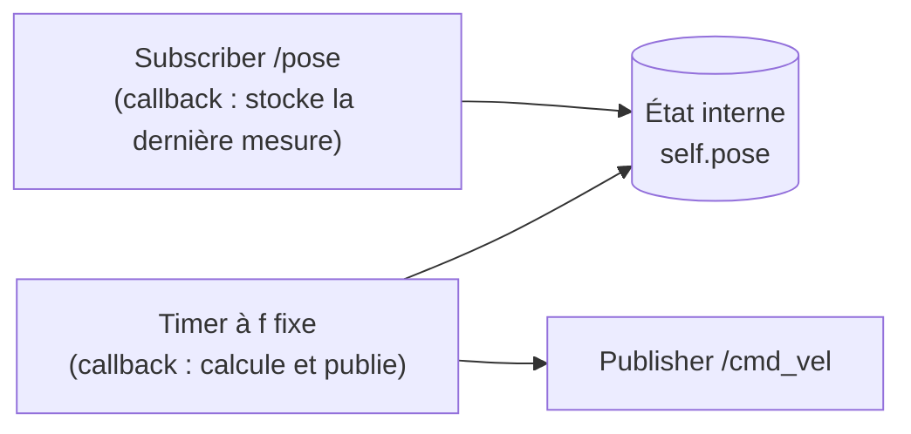

# 06 – Topics et qualité de service (QoS)

## Objectifs pédagogiques

| Niveau (Bloom) | Objectif |
| --- | --- |
| Comprendre | Expliquer les politiques de QoS (fiabilité, durabilité, historique) et leurs règles de compatibilité. |
| Appliquer | Écrire un publisher et un subscriber en `rclpy`, avec un profil de QoS explicite. |
| Appliquer | Fermer une boucle de commande : subscriber de mesure, timer de commande, publisher d'actionneur. |
| Analyser | Diagnostiquer une communication qui ne passe pas (nom, type, QoS) avec la CLI. |
| Évaluer | Justifier la structure d'un régulateur pour un robot non holonome. |

**Prérequis** : [05 – Nœuds](05_noeuds.md) (squelette de `pid_regulator`).

---

## Sommaire

- [1. Rappels](#1-rappels)
- [2. Publisher](#2-publisher)
- [3. Subscriber](#3-subscriber)
- [4. Qualité de service (QoS)](#4-qualité-de-service-qos)
- [5. Patron « mesure → commande »](#5-patron--mesure--commande-)
- [6. Bonnes pratiques](#6-bonnes-pratiques)
- [7. Exercice fil rouge : régulateur de position pour turtlesim](#7-exercice-fil-rouge--régulateur-de-position-pour-turtlesim)
- [8. Questions d'évaluation](#8-questions-dévaluation)

---

## 1. Rappels

Un topic est un canal **nommé** et **typé**, de modèle publication / abonnement (voir la Partie I, chapitre 01) :
- **asynchrone** : le publisher n'attend aucun subscriber ;
- **N → M** : plusieurs publishers et plusieurs subscribers peuvent partager un même topic ;
- **typé** : tous les messages d'un topic ont le même type (`geometry_msgs/msg/Twist`, `turtlesim/msg/Pose`…).

Trois conditions sont nécessaires pour que deux nœuds communiquent : **même nom résolu**, **même type** et **QoS compatibles**.

---

## 2. Publisher

```python
import rclpy
from rclpy.executors import ExternalShutdownException
from rclpy.node import Node
from std_msgs.msg import String


class Talker(Node):
    def __init__(self) -> None:
        super().__init__('talker')
        # (type, nom, QoS) ; un entier = profondeur d'historique avec les QoS par défaut
        self.pub = self.create_publisher(String, 'chatter', 10)
        self.count = 0
        self.timer = self.create_timer(0.5, self.on_timer)

    def on_timer(self) -> None:
        msg = String()
        msg.data = f'Bonjour ROS 2 #{self.count}'
        self.pub.publish(msg)
        self.count += 1
        self.get_logger().info(f'Publié : {msg.data}', throttle_duration_sec=2.0)


def main(args=None) -> None:
    rclpy.init(args=args)
    node = Talker()
    try:
        rclpy.spin(node)
    except (KeyboardInterrupt, ExternalShutdownException):
        pass
    finally:
        node.destroy_node()
        rclpy.try_shutdown()
```

`create_publisher(msg_type, topic, qos_profile)` :

| Argument | Rôle |
| --- | --- |
| `msg_type` | Classe Python du message, importée depuis `<package>.msg` |
| `topic` | Nom **relatif** de préférence (`'chatter'`, `'turtle1/cmd_vel'`), résolu dans le namespace du nœud |
| `qos_profile` | `QoSProfile` complet, ou un entier (profondeur) avec les autres politiques par défaut |

> Le nom d'un topic **n'a pas à être unique** : c'est précisément le nom partagé qui relie publishers et subscribers. Il doit être **explicite** et cohérent avec les conventions (`cmd_vel`, `scan`, `odom`, `imu/data`…).

---

## 3. Subscriber

```python
from std_msgs.msg import String


class Listener(Node):
    def __init__(self) -> None:
        super().__init__('listener')
        self.sub = self.create_subscription(String, 'chatter', self.on_msg, 10)

    def on_msg(self, msg: String) -> None:
        self.get_logger().info(f'Reçu : {msg.data}')
```

`create_subscription(msg_type, topic, callback, qos_profile)` : le callback reçoit **un seul argument**, le message. Il doit rester **court** : stocker la donnée, éventuellement la prétraiter, et rendre la main.

> **Attention à la référence.** Conservez l'objet renvoyé (`self.sub = ...`). Sans référence, l'abonnement peut être détruit par le ramasse-miettes Python et le callback ne sera jamais appelé.

---

## 4. Qualité de service (QoS)

### 4.1 Politiques

| Politique | Valeurs | Signification |
| --- | --- | --- |
| **History** | `KEEP_LAST` (avec `depth`), `KEEP_ALL` | Taille de la file d'attente côté émetteur et côté récepteur |
| **Reliability** | `RELIABLE`, `BEST_EFFORT` | Retransmission des messages perdus, ou non |
| **Durability** | `VOLATILE`, `TRANSIENT_LOCAL` | Un subscriber arrivé tard reçoit-il les derniers messages publiés ? |
| **Deadline** | durée | Période maximale attendue entre deux messages |
| **Lifespan** | durée | Âge au-delà duquel un message est jeté |
| **Liveliness** | `AUTOMATIC`, `MANUAL_BY_TOPIC` + *lease duration* | Détection de la disparition d'un publisher |

### 4.2 Profils prédéfinis

| Profil | Reliability | Durability | Depth | Usage |
| --- | --- | --- | --- | --- |
| Par défaut (entier `10`) | RELIABLE | VOLATILE | 10 | Commandes, états |
| `qos_profile_sensor_data` | BEST_EFFORT | VOLATILE | 5 | Capteurs à haut débit : la donnée fraîche prime sur la complète |
| *Latched* (à construire) | RELIABLE | TRANSIENT_LOCAL | 1 | Données publiées rarement : carte, `/tf_static`, `robot_description` |

```python
from rclpy.qos import (QoSProfile, ReliabilityPolicy, DurabilityPolicy,
                       HistoryPolicy, qos_profile_sensor_data)

latched = QoSProfile(
    depth=1,
    history=HistoryPolicy.KEEP_LAST,
    reliability=ReliabilityPolicy.RELIABLE,
    durability=DurabilityPolicy.TRANSIENT_LOCAL,
)
self.map_pub = self.create_publisher(OccupancyGrid, 'map', latched)
self.scan_sub = self.create_subscription(LaserScan, 'scan', self.on_scan, qos_profile_sensor_data)
```

### 4.3 Compatibilité : le modèle « offert / demandé »

Le publisher **offre** une qualité, le subscriber en **demande** une. La connexion s'établit seulement si l'offre est **au moins aussi forte** que la demande.

| Publisher (offre) | Subscriber (demande) | Connexion |
| --- | --- | --- |
| RELIABLE | RELIABLE ou BEST_EFFORT | ✅ |
| BEST_EFFORT | BEST_EFFORT | ✅ |
| BEST_EFFORT | RELIABLE | ❌ |
| TRANSIENT_LOCAL | TRANSIENT_LOCAL ou VOLATILE | ✅ |
| VOLATILE | TRANSIENT_LOCAL | ❌ |

En cas d'incompatibilité, **aucun message ne passe**. ROS 2 se contente d'écrire un avertissement dans les logs (*« offering incompatible QoS »*), facile à manquer. Diagnostic :

```bash
ros2 topic info /scan -v          # QoS de chaque publisher et de chaque subscriber
ros2 topic echo /scan --qos-reliability best_effort   # écouter un capteur BEST_EFFORT depuis la CLI
```

### 4.4 Choisir `depth`

- **Commande de bas niveau** (`cmd_vel` à 50 Hz) : une file courte (1 à 10). Un vieux message de commande n'a pas de valeur.
- **Événements** à ne pas perdre (détections, transitions d'état) : RELIABLE avec une file plus longue.
- **Coût mémoire** : $\text{depth} \times \text{taille du message}$, par publisher **et** par subscriber. Pour un nuage de points de 2 Mo, `depth=10` représente déjà 20 Mo de chaque côté, ce qui est significatif sur une carte embarquée.

---

## 5. Patron « mesure → commande »

Une boucle de commande ROS 2 sépare trois rôles :



- Le **callback de mesure** se contente de mémoriser la dernière valeur, avec son horodatage.
- Le **timer** fixe la fréquence de commande, indépendamment de la fréquence du capteur. Il calcule la commande à partir de la dernière mesure disponible.
- Si aucune mesure n'est arrivée (ou si elle est trop ancienne), le timer publie une **commande nulle** : c'est le comportement sûr par défaut.

Commander directement dans le callback de mesure est possible (cadence imposée par le capteur), mais couple la fréquence de commande à celle du capteur et complique la gestion d'une mesure absente.

---

## 6. Bonnes pratiques

1. **Noms relatifs** (`turtle1/cmd_vel`) pour que le namespace s'applique (chapitre 08).
2. **Types standard** (`geometry_msgs`, `sensor_msgs`, `nav_msgs`) avant de créer un message personnalisé.
3. **QoS explicite** et adaptée au flux : `qos_profile_sensor_data` pour les capteurs, RELIABLE pour les commandes, TRANSIENT_LOCAL pour les données rares.
4. **Callbacks courts** ; le calcul se fait dans le timer.
5. **Commande nulle** à l'arrêt du nœud et en cas de mesure périmée.
6. **Vérifier à la CLI** (`ros2 topic echo`, `hz`, `info -v`) avant de connecter un nouveau nœud.

---

## 7. Exercice fil rouge : régulateur de position pour turtlesim

### 7.1 Énoncé

Compléter le nœud `pid_regulator` du chapitre 05 pour amener la tortue d'une pose initiale à une **pose cible** $(x_d, y_d, \theta_d)$, fixée en dur dans le code pour l'instant (elle deviendra un paramètre au chapitre 07, puis une requête de service ou d'action aux chapitres 10 et 11).

### 7.2 Modèle et choix de la loi de commande

La tortue est un **unicycle** (robot non holonome) :

$$
\dot x = v\cos\theta, \qquad \dot y = v\sin\theta, \qquad \dot\theta = \omega
$$

avec $u = (v, \omega)$ la commande publiée dans `geometry_msgs/msg/Twist` (`linear.x` et `angular.z`).

**Difficulté.** On ne peut pas régler $x$, $y$ et $\theta$ par trois PID indépendants. Le système n'a que deux entrées pour trois sorties, et Brockett (1983) a montré qu'**aucun retour d'état continu et stationnaire** ne stabilise asymptotiquement un unicycle en une pose. On contourne ce résultat de deux façons classiques :

- **Approche en deux phases** (demandée ici) : rejoindre d'abord la **position**, puis corriger l'**orientation** finale sur place. La loi est discontinue au changement de phase, ce qui contourne l'hypothèse de Brockett.
- **Loi en coordonnées polaires** (approfondissement) : Aicardi et al. (1995), ou la loi linéaire de Siegwart et Nourbakhsh (2011, § 3.6), définie avec $\rho$ et $\alpha$ comme ci-dessous, $\beta = -\theta - \alpha + \theta_d$ et $v = k_\rho \rho$, $\omega = k_\alpha \alpha + k_\beta \beta$. Elle est localement exponentiellement stable si $k_\rho > 0$, $k_\beta < 0$ et $k_\alpha - k_\rho > 0$. Ce changement de coordonnées est singulier en $\rho = 0$, ce qui permet d'échapper au théorème.

**Erreurs utilisées** (avec $\Delta x = x_d - x$, $\Delta y = y_d - y$) :

$$
\rho = \sqrt{\Delta x^2 + \Delta y^2}, \qquad
\alpha = \operatorname{wrap}\!\big(\operatorname{atan2}(\Delta y, \Delta x) - \theta\big), \qquad
e_\theta = \operatorname{wrap}(\theta_d - \theta)
$$

où $\operatorname{wrap}(a) = \operatorname{atan2}(\sin a, \cos a) \in\ ]-\pi, \pi]$. **Sans ce repliement**, la tortue fait un tour complet dès que l'erreur angulaire franchit $\pm\pi$.

**Loi en deux phases :**

| Phase | Condition | Commande |
| --- | --- | --- |
| 1 – Rejoindre la position | $\rho > \varepsilon_\rho$ | $v = \operatorname{sat}\big(\mathrm{PID}_\rho(\rho)\big)\cdot\max(0, \cos\alpha)$, $\omega = \operatorname{sat}\big(\mathrm{PID}_\alpha(\alpha)\big)$ |
| 2 – Orientation finale | $\rho \le \varepsilon_\rho$ et $\lvert e_\theta\rvert > \varepsilon_\theta$ | $v = 0$, $\omega = \operatorname{sat}\big(\mathrm{PID}_\theta(e_\theta)\big)$ |
| Arrivé | $\rho \le \varepsilon_\rho$ et $\lvert e_\theta\rvert \le \varepsilon_\theta$ | $v = 0$, $\omega = 0$ |

Le facteur $\max(0, \cos\alpha)$ fait d'abord tourner la tortue sur place quand elle est mal orientée ($\lvert\alpha\rvert \ge \pi/2$), puis la fait avancer d'autant plus vite qu'elle est alignée. Prévoyez une **hystérésis** sur $\varepsilon_\rho$ (par exemple sortir de la phase 2 seulement si $\rho > 2\varepsilon_\rho$) pour éviter les oscillations entre phases.

### 7.3 Correcteur PID discret

À chaque pas, avec $\Delta t_k$ **mesuré** (chapitre 05) :

$$
u_k = K_p e_k + K_i I_k + K_d \frac{e_k - e_{k-1}}{\Delta t_k}, \qquad I_k = I_{k-1} + e_k \Delta t_k
$$

Exigences :
- **Saturation** de la sortie ($\lvert v\rvert \le v_{\max}$, $\lvert\omega\rvert \le \omega_{\max}$) ;
- **Anti-windup** : ne pas intégrer quand la sortie est saturée dans le sens de l'erreur (*conditional integration*), ou borner $I_k$ ;
- **Remise à zéro** de l'intégrale et de l'erreur précédente à chaque changement de phase ou de cible, ce qui évite le « coup de dérivée » ;
- **Erreur angulaire repliée** avant le calcul de la dérivée.

Classe fournie (Python pur, indépendante de ROS), à placer dans `turtle_controller/turtle_controller/pid.py` :

```python
from dataclasses import dataclass, field


@dataclass
class Pid:
    """PID discret avec saturation et anti-windup par intégration conditionnelle."""
    kp: float
    ki: float = 0.0
    kd: float = 0.0
    u_max: float = float('inf')
    _integral: float = field(default=0.0, init=False)
    _prev_error: float | None = field(default=None, init=False)

    def reset(self) -> None:
        self._integral = 0.0
        self._prev_error = None

    def update(self, error: float, dt: float) -> float:
        if dt <= 0.0:
            return 0.0
        derivative = 0.0 if self._prev_error is None else (error - self._prev_error) / dt
        self._prev_error = error
        u_unsat = self.kp * error + self.ki * (self._integral + error * dt) + self.kd * derivative
        u = max(-self.u_max, min(self.u_max, u_unsat))
        # N'intègre que si l'on n'est pas saturé, ou si l'intégration fait sortir de la saturation
        if u == u_unsat or (u_unsat > 0) != (error > 0):
            self._integral += error * dt
        return u
```

> Le module `pid.py` étant dans le même package Python, on l'importe dans le nœud avec `from turtle_controller.pid import Pid`.

### 7.4 Squelette du nœud

```python
import math

import rclpy
from geometry_msgs.msg import Twist
from rclpy.executors import ExternalShutdownException
from rclpy.node import Node
from turtlesim.msg import Pose

from turtle_controller.pid import Pid


def wrap(a: float) -> float:
    return math.atan2(math.sin(a), math.cos(a))


class PidRegulator(Node):
    def __init__(self) -> None:
        super().__init__('pid_regulator')
        # Cible (paramètre au chapitre 07)
        self.x_d, self.y_d, self.theta_d = 8.0, 8.0, math.pi / 2
        self.eps_rho, self.eps_theta = 0.05, 0.02

        self.pid_rho = Pid(kp=1.0, ki=0.0, kd=0.0, u_max=2.0)
        self.pid_alpha = Pid(kp=4.0, ki=0.0, kd=0.0, u_max=2.0)
        self.pid_theta = Pid(kp=3.0, ki=0.0, kd=0.0, u_max=1.5)

        self.pose: Pose | None = None
        self.pose_stamp = None
        self.phase = 1

        # TODO 1 : subscriber sur 'turtle1/pose' (nom relatif) → self.on_pose
        # TODO 2 : publisher Twist sur 'turtle1/cmd_vel'
        self.t_prev = self.get_clock().now()
        self.timer = self.create_timer(0.02, self.control_loop)      # 50 Hz
        self.get_logger().info('Node pid_regulator has been created successfully!')

    def on_pose(self, msg: Pose) -> None:
        # TODO 3 : mémoriser msg et son horodatage de réception
        pass

    def control_loop(self) -> None:
        now = self.get_clock().now()
        dt = (now - self.t_prev).nanoseconds * 1e-9
        self.t_prev = now
        cmd = Twist()
        # TODO 4 : si pas de pose, ou pose plus vieille que 0,2 s → publier cmd nulle et sortir
        # TODO 5 : calculer rho, alpha, e_theta ; gérer les phases (avec hystérésis) ;
        #          remettre les PID à zéro à chaque changement de phase
        # TODO 6 : remplir cmd.linear.x et cmd.angular.z, publier
        # TODO 7 : journaliser (throttle 1 s) la phase, rho et e_theta

    def stop(self) -> None:
        # Commande nulle avant de quitter (appelée dans main avant destroy_node)
        pass


def main(args=None) -> None:
    rclpy.init(args=args)
    node = PidRegulator()
    try:
        rclpy.spin(node)
    except (KeyboardInterrupt, ExternalShutdownException):
        pass
    finally:
        node.stop()
        node.destroy_node()
        rclpy.try_shutdown()
```

### 7.5 Test

```bash
T1$ ros2 run turtlesim turtlesim_node
T2$ ros2 run turtle_controller pid_regulator
T3$ ros2 run rqt_plot rqt_plot /turtle1/pose/x /turtle1/pose/y /turtle1/pose/theta
T4$ ros2 service call /turtle1/teleport_absolute turtlesim/srv/TeleportAbsolute "{x: 1.0, y: 1.0, theta: -3.0}"
```

### 7.6 Critères de validation

- Erreur finale $\rho < 0{,}05$ et $\lvert e_\theta\rvert < 0{,}02$ rad, depuis au moins trois poses initiales différentes, dont une avec $\theta$ proche de $\pm\pi$.
- Vitesses toujours dans les bornes ($\lvert v\rvert \le 2$, $\lvert\omega\rvert \le 2$) : vérifiez avec `ros2 topic echo /turtle1/cmd_vel`.
- La tortue s'arrête si `turtlesim_node` est tué puis relancé (pose périmée → commande nulle).
- Ctrl+C sur `pid_regulator` arrête la tortue.

### 7.7 Pour aller plus loin

1. Comparez $K_i = 0$ et $K_i > 0$ sur $\rho$ : l'intégrale est-elle utile pour ce système ? Justifiez par la présence ou non d'une perturbation constante dans le modèle.
2. Implémentez la loi polaire de Siegwart et comparez les trajectoires (temps d'arrivée, longueur du chemin).
3. Publiez les erreurs $(\rho, \alpha, e_\theta)$ sur un topic de débogage, par exemple `~/errors` de type `geometry_msgs/msg/Vector3`, et tracez-les avec `rqt_plot`.

---

## 8. Questions d'évaluation

1. Citez les trois conditions nécessaires pour qu'un subscriber reçoive les messages d'un publisher.
2. Un pilote de lidar publie en BEST_EFFORT et votre nœud s'abonne avec la QoS par défaut. Que se passe-t-il ? Comment le détecter ? Comment corriger ?
3. Pourquoi `/tf_static` et une carte d'occupation utilisent-ils la durabilité TRANSIENT_LOCAL ?
4. Pourquoi faut-il replier l'erreur angulaire dans $]-\pi, \pi]$ ? Donnez un exemple numérique où l'oubli provoque un demi-tour inutile.
5. Expliquez pourquoi trois PID indépendants sur $x$, $y$ et $\theta$ ne permettent pas d'atteindre une pose quelconque avec un unicycle.
6. Quels sont les avantages de calculer la commande dans un timer plutôt que dans le callback de pose ?

## Références

- R. W. Brockett, « Asymptotic stability and feedback stabilization », in *Differential Geometric Control Theory*, Birkhäuser, 1983.
- M. Aicardi, G. Casalino, A. Bicchi, A. Balestrino, « Closed loop steering of unicycle-like vehicles via Lyapunov techniques », *IEEE Robotics & Automation Magazine*, 2(1), 1995.
- R. Siegwart, I. R. Nourbakhsh, D. Scaramuzza, *Introduction to Autonomous Mobile Robots*, 2e éd., MIT Press, 2011, § 3.6.
- K. J. Åström, R. M. Murray, *Feedback Systems*, 2e éd., Princeton University Press, 2021, chap. 11 (PID, anti-windup).
- Documentation QoS (Jazzy) : <https://docs.ros.org/en/jazzy/Concepts/Intermediate/About-Quality-of-Service-Settings.html>
