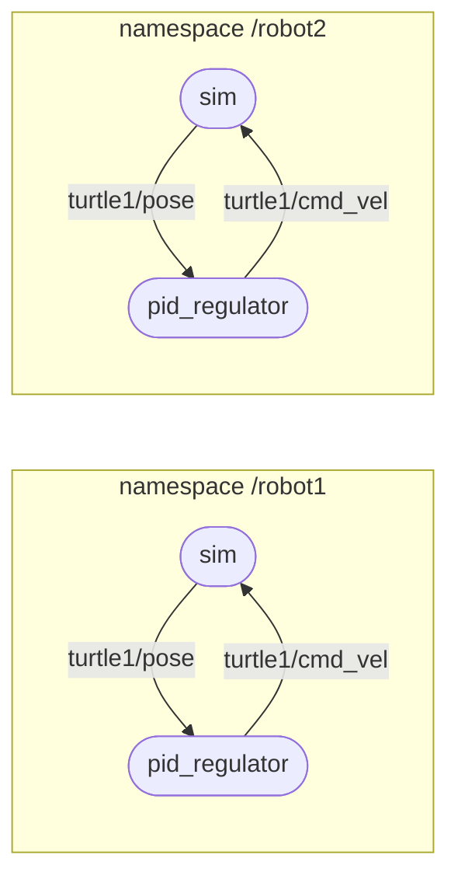

# 08 – Launch files

## Objectifs pédagogiques

À la fin de ce chapitre, vous saurez :

- expliquer à quoi sert un launch file et comment certaines valeurs ne sont calculées qu'au moment du lancement ;
- écrire un launch file Python qui démarre plusieurs nœuds avec leurs paramètres, leurs remappings et leur namespace ;
- ajouter des arguments de lancement et réutiliser un autre launch file ;
- lancer plusieurs robots identiques en changeant seulement leur namespace.

**Prérequis** : [07 – Paramètres](07_parametres.md).

---

## Sommaire

- [1. Pourquoi des launch files ?](#1-pourquoi-des-launch-files-)
- [2. Premier launch file](#2-premier-launch-file)
- [3. Installer et lancer](#3-installer-et-lancer)
- [4. Arguments et substitutions](#4-arguments-et-substitutions)
- [5. Namespaces et remappings](#5-namespaces-et-remappings)
- [6. Composer des launch files](#6-composer-des-launch-files)
- [7. Autres formats : XML et YAML](#7-autres-formats--xml-et-yaml)
- [8. Exercice fil rouge](#8-exercice-fil-rouge)
- [9. Questions d'évaluation](#9-questions-dévaluation)

---

## 1. Pourquoi des launch files ?

Lancer `turtlesim_node`, `pid_regulator` avec son fichier YAML, `rqt_graph` et `rviz2` demande quatre terminaux et des lignes de commande longues. Un **launch file** décrit ce système de façon déclarative et reproductible :

- quels nœuds lancer, avec quels **paramètres**, **remappings** et **namespaces** ;
- quels **arguments** l'utilisateur peut fournir (`namespace:=robot1`, `use_sim_time:=true`) ;
- quels autres launch files **inclure** (par exemple un simulateur fourni par un autre package).

Un launch file Python n'est **pas** un script exécuté pas à pas : il **construit une description** (`LaunchDescription`) que le système de lancement évalue ensuite. Les valeurs dépendant des arguments (`LaunchConfiguration`) ne sont connues qu'à ce moment-là. C'est pourquoi on ne peut pas faire un `if` Python sur un argument : on utilise des **substitutions** et des **conditions**.

---

## 2. Premier launch file

Fichier `turtle_controller/launch/turtle_pid.launch.py` :

```python
from launch import LaunchDescription
from launch.substitutions import PathJoinSubstitution
from launch_ros.actions import Node
from launch_ros.substitutions import FindPackageShare


def generate_launch_description() -> LaunchDescription:
    params = PathJoinSubstitution([FindPackageShare('turtle_controller'), 'config', 'pid_params.yaml'])

    sim = Node(
        package='turtlesim',
        executable='turtlesim_node',
        name='sim',
    )
    controller = Node(
        package='turtle_controller',
        executable='pid_regulator',
        name='pid_regulator',
        parameters=[params, {'tolerance.position': 0.05}],   # fichier puis surcharge
        output='screen',
    )
    return LaunchDescription([sim, controller])
```

| Argument de `Node` | Équivalent CLI |
| --- | --- |
| `package`, `executable` | `ros2 run <package> <executable>` |
| `name` | `-r __node:=<name>` |
| `namespace` | `-r __ns:=<namespace>` |
| `parameters=[fichier, {dict}]` | `--params-file`, `-p` (appliqués dans l'ordre) |
| `remappings=[('a', 'b')]` | `-r a:=b` |
| `arguments=[...]` | arguments de la ligne de commande du programme |
| `output='screen'` | affiche stdout/stderr dans le terminal |

---

## 3. Installer et lancer

`setup.py` : installez le dossier `launch/` (et `config/`, chapitre 07).

```python
import os
from glob import glob
...
data_files=[
    ('share/ament_index/resource_index/packages', ['resource/' + package_name]),
    ('share/' + package_name, ['package.xml']),
    (os.path.join('share', package_name, 'launch'), glob('launch/*.launch.py')),
    (os.path.join('share', package_name, 'config'), glob('config/*.yaml')),
],
```

`package.xml` : déclarez les dépendances d'exécution.

```xml
<exec_depend>launch</exec_depend>
<exec_depend>launch_ros</exec_depend>
<exec_depend>turtlesim</exec_depend>
```

```bash
colcon build --symlink-install --packages-select turtle_controller
source install/setup.bash
ros2 launch turtle_controller turtle_pid.launch.py
ros2 launch turtle_controller turtle_pid.launch.py --show-args     # liste les arguments exposés
```

> Avec `--symlink-install`, la modification d'un fichier launch existant ne nécessite pas de recompiler le package. En revanche, l'ajout d'un nouveau fichier launch peut nécessiter de relancer la commande colcon build.

---

## 4. Arguments et substitutions

```python
from launch import LaunchDescription
from launch.actions import DeclareLaunchArgument
from launch.conditions import IfCondition
from launch.substitutions import LaunchConfiguration, PathJoinSubstitution
from launch_ros.actions import Node
from launch_ros.substitutions import FindPackageShare


def generate_launch_description() -> LaunchDescription:
    namespace = LaunchConfiguration('namespace')
    params_file = LaunchConfiguration('params_file')
    use_graph = LaunchConfiguration('graph')

    return LaunchDescription([
        DeclareLaunchArgument('namespace', default_value='',
                              description='Namespace du robot (vide = racine)'),
        DeclareLaunchArgument('params_file',
                              default_value=PathJoinSubstitution(
                                  [FindPackageShare('turtle_controller'), 'config', 'pid_params.yaml']),
                              description='Fichier YAML de paramètres du régulateur'),
        DeclareLaunchArgument('graph', default_value='false',
                              description='Lancer rqt_graph'),

        Node(package='turtlesim', executable='turtlesim_node', name='sim', namespace=namespace),
        Node(package='turtle_controller', executable='pid_regulator', name='pid_regulator',
             namespace=namespace, parameters=[params_file], output='screen'),
        Node(package='rqt_graph', executable='rqt_graph',
             condition=IfCondition(use_graph)),
    ])
```

```bash
ros2 launch turtle_controller turtle_pid.launch.py namespace:=robot1 graph:=true
```

| Substitution | Valeur à l'évaluation |
| --- | --- |
| `LaunchConfiguration('x')` | Valeur de l'argument `x` |
| `FindPackageShare('pkg')` | Dossier `share/` installé du package |
| `PathJoinSubstitution([...])` | Concaténation de chemins |
| `EnvironmentVariable('VAR')` | Variable d'environnement |
| `PythonExpression([...])` | Expression Python évaluée au lancement |

> Ne construisez **jamais** un chemin avec `os.path.join(get_package_share_directory(...), ...)` à partir d'un argument de lancement : l'argument n'est pas encore connu quand Python exécute `generate_launch_description()`. Pour un chemin fixe, `get_package_share_directory` reste acceptable.

---

## 5. Namespaces et remappings

C'est ici que la règle des **noms relatifs** (chapitres 05 et 06) prend tout son sens. Si `pid_regulator` s'abonne à `turtle1/pose` (relatif), le lancer dans `namespace:=robot1` le connecte automatiquement à `/robot1/turtle1/pose`, publié par le `turtlesim_node` du même namespace.



Le fichier YAML utilise `/**` : il s'applique quel que soit le namespace.

**Remapping** quand les noms ne correspondent pas :

```python
Node(package='turtle_controller', executable='pid_regulator',
     remappings=[('turtle1/pose', 'odom_pose'), ('turtle1/cmd_vel', 'cmd_vel')])
```

**Grouper** plusieurs nœuds sous un même namespace :

```python
from launch.actions import GroupAction
from launch_ros.actions import PushRosNamespace

GroupAction([
    PushRosNamespace('robot1'),
    Node(package='turtlesim', executable='turtlesim_node', name='sim'),
    Node(package='turtle_controller', executable='pid_regulator', parameters=[params]),
])
```

---

## 6. Composer des launch files

```python
from launch.actions import IncludeLaunchDescription
from launch.launch_description_sources import PythonLaunchDescriptionSource

robot = lambda ns: IncludeLaunchDescription(
    PythonLaunchDescriptionSource(
        PathJoinSubstitution([FindPackageShare('turtle_controller'), 'launch', 'turtle_pid.launch.py'])),
    launch_arguments={'namespace': ns}.items(),
)

def generate_launch_description():
    return LaunchDescription([robot('robot1'), robot('robot2')])
```

Autres actions utiles : `ExecuteProcess` (commande quelconque), `TimerAction` (lancement différé), `RegisterEventHandler` + `OnProcessExit` (réagir à la fin d'un processus), `SetEnvironmentVariable`, `SetParameter` (paramètre global au launch, par exemple `use_sim_time`).

---

## 7. Autres formats : XML et YAML

Pour des systèmes simples, les formats déclaratifs sont plus lisibles :

```xml
<!-- launch/turtle_pid.launch.xml -->
<launch>
  <arg name="namespace" default=""/>
  <node pkg="turtlesim" exec="turtlesim_node" name="sim" namespace="$(var namespace)"/>
  <node pkg="turtle_controller" exec="pid_regulator" name="pid_regulator" namespace="$(var namespace)">
    <param from="$(find-pkg-share turtle_controller)/config/pid_params.yaml"/>
  </node>
</launch>
```

Le format Python reste nécessaire dès qu'il faut de la logique (boucles, conditions complexes, gestion d'événements).

---

## 8. Exercice fil rouge

1. **Lancement simple.** Écrivez `launch/turtle_pid.launch.py` qui démarre `turtlesim_node` et `pid_regulator` avec `config/pid_params.yaml`. Installez-le et testez-le.
2. **Arguments.** Exposez `namespace`, `params_file` et `graph`. Vérifiez avec `--show-args`.
3. **Deux robots.** Écrivez `launch/two_turtles.launch.py` qui inclut deux fois le précédent (`robot1`, `robot2`). Les deux tortues doivent rejoindre leur cible indépendamment.
4. **Cibles différentes.** Donnez à `robot2` une cible différente sans dupliquer le fichier YAML (surcharge par dictionnaire dans `parameters`, ou second argument de lancement).
5. **Vérification.**
   ```bash
   ros2 node list                    # /robot1/sim, /robot1/pid_regulator, /robot2/…
   ros2 topic list | grep cmd_vel    # /robot1/turtle1/cmd_vel, /robot2/turtle1/cmd_vel
   ros2 run rqt_graph rqt_graph      # deux sous-graphes disjoints
   ```

**Critère de validation** : `ros2 launch turtle_controller two_turtles.launch.py` suffit à lancer et à faire converger les deux robots, sans aucune autre commande.

**Si un robot ne bouge pas** : votre nœud utilise sans doute un nom **absolu** (`/turtle1/cmd_vel`). Corrigez le code plutôt que d'ajouter des remappings.

---

## 9. Questions d'évaluation

1. Pourquoi ne peut-on pas tester la valeur d'un `LaunchConfiguration` avec un `if` Python dans `generate_launch_description()` ?
2. Quelle est la différence entre `namespace=` sur un `Node` et `PushRosNamespace` dans un `GroupAction` ?
3. Dans quel ordre s'appliquent les éléments de la liste `parameters=[fichier, {dict}]` ?
4. Pourquoi l'usage de `/**` dans le YAML facilite-t-il le déploiement multi-robots ?
5. Votre launch file fonctionne dans le workspace de développement mais pas sur le robot : le fichier YAML est introuvable. Quelles sont les deux causes les plus probables ?

## Références

- Tutoriels Launch (Jazzy) : <https://docs.ros.org/en/jazzy/Tutorials/Intermediate/Launch/Launch-Main.html>
- Substitutions : <https://docs.ros.org/en/jazzy/Tutorials/Intermediate/Launch/Using-Substitutions.html>
