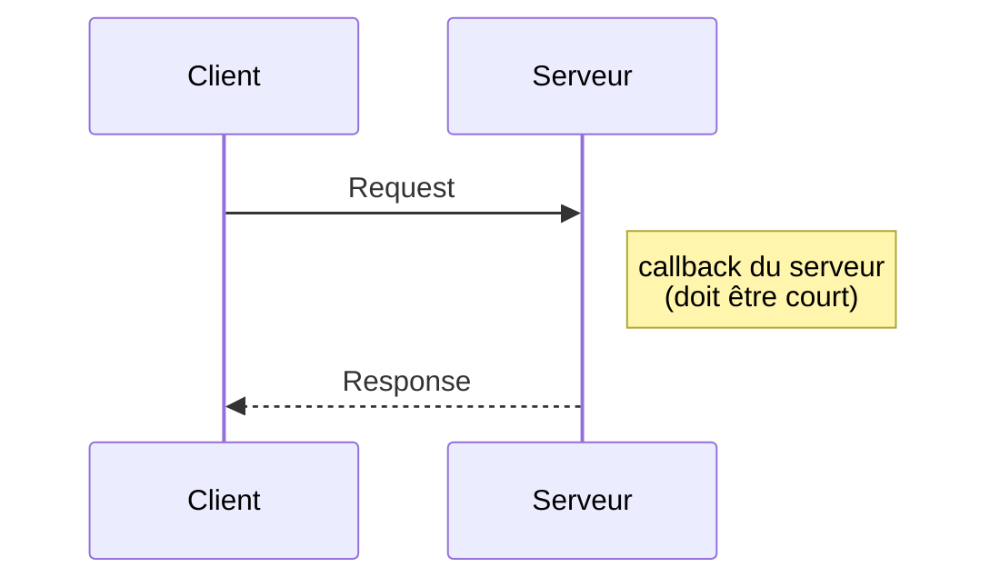
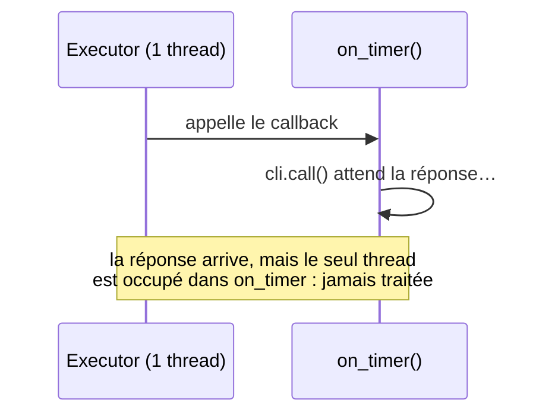

# 10 – Services

## Objectifs pédagogiques

À la fin de ce chapitre, vous saurez :

- écrire un serveur de service et un client asynchrone en `rclpy` ;
- expliquer pourquoi un appel synchrone dans un callback bloque le nœud pour toujours (interblocage) ;
- voir pourquoi un service ne convient pas à une tâche longue, et pourquoi une action est alors préférable.

**Prérequis** : [09 – Interfaces personnalisées](09_interfaces.md) (`turtle_interfaces/srv/SetTarget`).

---

## Sommaire

- [1. Rappels](#1-rappels)
- [2. Serveur](#2-serveur)
- [3. Client asynchrone](#3-client-asynchrone)
- [4. Le piège de l'interblocage](#4-le-piège-de-linterblocage)
- [5. CLI](#5-cli)
- [6. Bonnes pratiques](#6-bonnes-pratiques)
- [7. Exercice fil rouge](#7-exercice-fil-rouge)
- [8. Questions d'évaluation](#8-questions-dévaluation)

---

## 1. Rappels

Un service est un échange **requête / réponse** entre N clients et **un seul** serveur. Il convient aux opérations **ponctuelles et courtes** : remise à zéro, changement de mode, calcul rapide, configuration.



Côté middleware, l'appel est **toujours asynchrone** : le client envoie la requête puis reçoit la réponse plus tard, sous la forme d'un *future*. « Synchrone » ne décrit que la façon dont le client choisit d'attendre.

---

## 2. Serveur

```python
from turtle_interfaces.srv import SetTarget


class PidRegulator(Node):
    def __init__(self) -> None:
        super().__init__('pid_regulator')
        ...
        self.srv = self.create_service(SetTarget, '~/set_target', self.on_set_target)

    def on_set_target(self, request: SetTarget.Request,
                      response: SetTarget.Response) -> SetTarget.Response:
        if not (0.0 <= request.x <= 11.0 and 0.0 <= request.y <= 11.0):
            response.success = False
            response.message = f'Cible hors du domaine : ({request.x:.2f}, {request.y:.2f})'
            return response
        self.set_target(request.x, request.y)   # change la cible, passe en PHASE_MOVING
        response.success = True
        response.message = 'Cible acceptée'
        return response
```

- Le callback reçoit la requête et un objet réponse **pré-alloué**, qu'il remplit et **renvoie**.
- Le nom `~/set_target` est **privé** : il devient `/pid_regulator/set_target`, ou `/robot1/pid_regulator/set_target` dans un namespace.
- Le callback doit **rendre la main vite** : il s'exécute dans l'executor du nœud et bloque les autres callbacks tant qu'il tourne (chapitre 05).

---

## 3. Client asynchrone

```python
from turtle_interfaces.srv import SetTarget


class TargetClient(Node):
    def __init__(self) -> None:
        super().__init__('target_client')
        self.cli = self.create_client(SetTarget, 'pid_regulator/set_target')
        while not self.cli.wait_for_service(timeout_sec=1.0):
            self.get_logger().info('Service indisponible, nouvelle tentative…')
        self.send(5.0, 5.0)

    def send(self, x: float, y: float) -> None:
        req = SetTarget.Request(x=x, y=y)
        future = self.cli.call_async(req)
        future.add_done_callback(self.on_response)     # appelé par l'executor à la réception

    def on_response(self, future) -> None:
        try:
            res = future.result()
        except Exception as exc:                        # service disparu, erreur de transport…
            self.get_logger().error(f'Échec de l\'appel : {exc}')
            return
        self.get_logger().info(f'success={res.success} : {res.message}')
```

> **Bug fréquent** dans les tutoriels : créer la requête avec un autre type que celui du client (par exemple `TeleportAbsolute.Request()` pour un client `SetBool`). Le type de la requête doit être `<Type>.Request` du type passé à `create_client`.

### Variante : script séquentiel hors executor

Dans un **script** (pas dans un callback), on peut attendre la réponse en faisant tourner l'executor jusqu'à la complétion du *future* :

```python
future = self.cli.call_async(req)
rclpy.spin_until_future_complete(self, future, timeout_sec=5.0)
res = future.result()
```

C'est acceptable dans `main()` ou dans un outil en ligne de commande, **jamais dans un callback**.

---

## 4. Le piège de l'interblocage

`client.call(req)` (synchrone) **bloque** le thread appelant jusqu'à l'arrivée de la réponse. Or la réponse est elle-même délivrée par… l'executor du nœud. Avec un `SingleThreadedExecutor`, si `call()` est appelé dans un callback, le seul thread est bloqué et la réponse ne sera **jamais traitée** : c'est un **interblocage**.

```python
def on_timer(self):
    res = self.cli.call(SetTarget.Request(x=5.0, y=5.0))   # ❌ bloque pour toujours
```



Trois solutions, par ordre de préférence :

| Solution | Principe |
| --- | --- |
| **1. `call_async` + `add_done_callback`** | On ne bloque pas : la suite du traitement est dans le callback de réponse (section 3). |
| **2. Callback coroutine (`async def`)** | `rclpy` accepte les callbacks `async` : `res = await self.cli.call_async(req)` rend la main à l'executor pendant l'attente. |
| **3. `MultiThreadedExecutor` + callback groups** | Le callback appelant et le client sont dans des groupes différents ; un autre thread traite la réponse pendant que le premier attend. |

Exemple de la solution 2 :

```python
async def on_timer(self) -> None:
    res = await self.cli.call_async(SetTarget.Request(x=5.0, y=5.0))
    self.get_logger().info(res.message)
```

Exemple de la solution 3 :

```python
from rclpy.callback_groups import MutuallyExclusiveCallbackGroup
from rclpy.executors import MultiThreadedExecutor

self.client_group = MutuallyExclusiveCallbackGroup()
self.timer_group = MutuallyExclusiveCallbackGroup()
self.cli = self.create_client(SetTarget, 'pid_regulator/set_target', callback_group=self.client_group)
self.timer = self.create_timer(1.0, self.on_timer, callback_group=self.timer_group)
# dans main() :
executor = MultiThreadedExecutor()
executor.add_node(node)
executor.spin()
```

---

## 5. CLI

```bash
ros2 service list -t
ros2 service type /pid_regulator/set_target
ros2 interface show turtle_interfaces/srv/SetTarget
ros2 service call /pid_regulator/set_target turtle_interfaces/srv/SetTarget "{x: 8.0, y: 8.0}"
ros2 service echo /pid_regulator/set_target      # observe requêtes et réponses (Iron et ultérieures ; introspection à activer côté nœud)
```

---

## 6. Bonnes pratiques

1. **Callbacks serveur courts** : changer un état, lancer un traitement, répondre. Pas d'attente ni de boucle.
2. **Clients asynchrones** dans les nœuds ; `spin_until_future_complete` réservé aux scripts.
3. **Toujours tester `wait_for_service`** avec un délai, et gérer l'exception de `future.result()`.
4. **Réponse explicite** : un `success` et un `message` lisible par un humain.
5. **Nommage** : un service appartient en général à son serveur (`~/set_target`).
6. **Pas de service pour une tâche longue** : la réponse n'indiquerait que l'acceptation, pas l'achèvement.

---

## 7. Exercice fil rouge

### 7.1 Serveur dans `pid_regulator`

1. Ajoutez le serveur `~/set_target` (type `turtle_interfaces/srv/SetTarget`). Il valide la requête, met à jour la cible et relance le déplacement (`PHASE_MOVING`).
2. Testez avec la CLI :
   ```bash
   ros2 service call /pid_regulator/set_target turtle_interfaces/srv/SetTarget "{x: 2.0, y: 2.0}"
   ros2 service call /pid_regulator/set_target turtle_interfaces/srv/SetTarget "{x: 20.0, y: 2.0}"   # refus attendu
   ```

### 7.2 Client `turtle_navigation`

3. Créez le nœud `turtle_navigation` dans `turtle_controller`. Il lit un paramètre `waypoints` (`double[]` à plat : $[x_1, y_1, x_2, y_2, \dots]$) et envoie la **première** cible par service.
4. Étendez-le pour parcourir **toute la liste**, chaque cible n'étant envoyée qu'une fois la précédente **atteinte**.

### 7.3 Analyse

5. Que remarquez-vous à l'étape 4 ? La réponse du service arrive immédiatement après l'acceptation de la cible, bien avant que la tortue ne l'atteigne. Le client ne dispose d'aucune information sur l'achèvement.
6. Proposez et comparez des contournements :
   - le client s'abonne à `/pid_regulator/state` et attend `phase == PHASE_DONE` ;
   - le client attend une durée fixe ;
   - le client interroge périodiquement un second service `~/is_done`.
7. Pour chacun, discutez : couplage entre les nœuds, robustesse (cible inatteignable, annulation, préemption par un autre client), suivi de la progression. Concluez sur le mécanisme le plus adapté (chapitre 11).

**Critères de validation** : le serveur refuse une cible hors domaine ; `turtle_navigation` parcourt trois points de passage avec le contournement de votre choix ; aucune utilisation de `call()` synchrone dans un callback.

---

## 8. Questions d'évaluation

1. Pourquoi dit-on que l'appel de service est toujours asynchrone côté middleware ?
2. Décrivez précisément l'enchaînement qui mène à l'interblocage avec `call()` dans un callback de timer et un `SingleThreadedExecutor`.
3. Dans quels cas `rclpy.spin_until_future_complete` est-il acceptable ?
4. Le serveur `set_target` met 3 s à répondre parce qu'il attend l'arrivée de la tortue. Quels problèmes cela pose-t-il pour le nœud `pid_regulator` lui-même ?
5. Citez trois fonctionnalités offertes par une action et absentes d'un service.

## Références

- Services en Python (Jazzy) : <https://docs.ros.org/en/jazzy/Tutorials/Beginner-Client-Libraries/Writing-A-Simple-Py-Service-And-Client.html>
- Executors et callback groups : <https://docs.ros.org/en/jazzy/How-To-Guides/Using-callback-groups.html>
