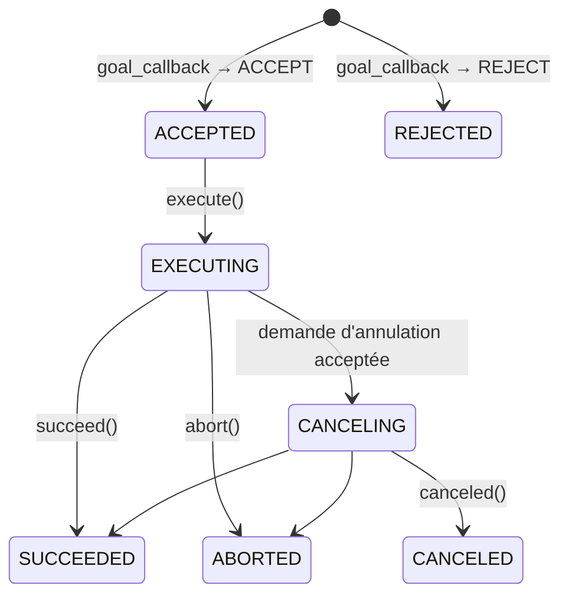

# 11 – Actions

## Objectifs pédagogiques

À la fin de ce chapitre, vous saurez :

- décrire les étapes de la vie d'un but (goal) et les états possibles d'une action ;
- écrire un serveur d'action qui valide un but, envoie un retour d'état, gère l'annulation et le remplacement par un nouveau but ;
- écrire un client d'action qui enchaîne plusieurs buts et suit leur avancement ;
- organiser un nœud qui traite plusieurs callbacks en parallèle (executor multithread, callback groups, verrou) ;
- transformer `pid_regulator` en serveur d'action `GoToPose` et `turtle_navigation` en client qui exécute une mission.

**Prérequis** : [10 – Services](10_services.md) et [05 – Nœuds](05_noeuds.md) (section 5, executors).

---

## Sommaire

- [1. Modèle d'une action](#1-modèle-dune-action)
- [2. Découvrir avec turtlesim](#2-découvrir-avec-turtlesim)
- [3. Serveur d'action](#3-serveur-daction)
- [4. Client d'action](#4-client-daction)
- [5. Concurrence : executor, groupes, verrou](#5-concurrence--executor-groupes-verrou)
- [6. Bonnes pratiques](#6-bonnes-pratiques)
- [7. Exercice fil rouge : mission de points de passage](#7-exercice-fil-rouge--mission-de-points-de-passage)
- [8. Questions d'évaluation](#8-questions-dévaluation)

---

## 1. Modèle d'une action

Une action sert aux **tâches longues** dont le client veut suivre la **progression** et qu'il veut pouvoir **annuler**. Elle est implémentée avec trois services et deux topics :

| Élément | Type | Rôle |
| --- | --- | --- |
| `send_goal` | service | Le client envoie un but ; le serveur l'**accepte** ou le **refuse** |
| `cancel_goal` | service | Le client demande l'annulation |
| `get_result` | service | Le client récupère le résultat final |
| `feedback` | topic | Le serveur publie la progression |
| `status` | topic | États de tous les buts en cours |

### États d'un but



- **Annulation** (*canceled*) : à l'initiative du **client**, acceptée par le serveur.
- **Abandon** (*aborted*) : à l'initiative du **serveur** (échec, délai dépassé, préemption par un nouveau but).
- La **politique** face à plusieurs buts simultanés est un choix du serveur : les refuser, les mettre en file, ou préempter le but en cours (comportement de `turtlesim`).

---

## 2. Découvrir avec turtlesim

```bash
T1$ ros2 run turtlesim turtlesim_node
T2$ ros2 action list -t
T2$ ros2 action info /turtle1/rotate_absolute
T2$ ros2 interface show turtlesim/action/RotateAbsolute
T2$ ros2 action send_goal /turtle1/rotate_absolute turtlesim/action/RotateAbsolute "{theta: 3.0}" --feedback
```

Pendant l'exécution, envoyez un second but depuis un autre terminal : le premier passe à l'état **ABORTED**, le second s'exécute.

---

## 3. Serveur d'action

### 3.1 Les quatre callbacks

| Callback | Appelé quand… | Renvoie |
| --- | --- | --- |
| `goal_callback(goal_request)` | un but arrive | `GoalResponse.ACCEPT` ou `REJECT` (validation rapide) |
| `handle_accepted_callback(goal_handle)` | le but est accepté | rien ; décide quand lancer `goal_handle.execute()` (préemption, file) |
| `execute_callback(goal_handle)` | le but s'exécute | le message `Result` ; appelle `succeed()`, `abort()` ou `canceled()` avant |
| `cancel_callback(goal_handle)` | une annulation est demandée | `CancelResponse.ACCEPT` ou `REJECT` |

### 3.2 Serveur `GoToPose` dans `pid_regulator`

Architecture retenue : la **boucle de commande reste dans le timer** (chapitre 06). Le callback d'exécution **ne commande pas** : il fixe la cible, surveille l'avancement, publie le retour d'état et termine le but. L'état partagé est protégé par un verrou.

```python
import threading
import time

from rclpy.action import ActionServer, CancelResponse, GoalResponse
from rclpy.callback_groups import MutuallyExclusiveCallbackGroup, ReentrantCallbackGroup
from rclpy.executors import ExternalShutdownException, MultiThreadedExecutor

from turtle_interfaces.action import GoToPose
from turtle_interfaces.msg import ControllerState


class PidRegulator(Node):
    def __init__(self) -> None:
        super().__init__('pid_regulator')
        ...                                             # paramètres, PID, pose (chapitres 06–07)
        self.lock = threading.Lock()
        self.goal_handle = None

        self.control_group = MutuallyExclusiveCallbackGroup()   # pose + timer : jamais en parallèle
        self.action_group = ReentrantCallbackGroup()            # callbacks d'action

        self.pose_sub = self.create_subscription(Pose, 'turtle1/pose', self.on_pose, 10,
                                                 callback_group=self.control_group)
        self.timer = self.create_timer(0.02, self.control_loop, callback_group=self.control_group)

        self.action_server = ActionServer(
            self, GoToPose, '~/go_to_pose',
            execute_callback=self.execute,
            goal_callback=self.on_goal,
            handle_accepted_callback=self.on_accepted,
            cancel_callback=self.on_cancel,
            callback_group=self.action_group,
        )

    # --- Validation ------------------------------------------------------
    def on_goal(self, goal: GoToPose.Goal) -> GoalResponse:
        if 0.0 <= goal.x <= 11.0 and 0.0 <= goal.y <= 11.0:
            return GoalResponse.ACCEPT
        self.get_logger().warn(f'But refusé : ({goal.x:.2f}, {goal.y:.2f}) hors du domaine')
        return GoalResponse.REJECT

    # --- Politique : un seul but, le plus récent préempte ----------------
    def on_accepted(self, goal_handle) -> None:
        with self.lock:
            if self.goal_handle is not None and self.goal_handle.is_active:
                self.get_logger().info('Nouveau but : préemption du but en cours')
                self.goal_handle.abort()
            self.goal_handle = goal_handle
            g = goal_handle.request
            self.set_target(g.x, g.y)                   # nouvelle cible, PHASE_MOVING
        goal_handle.execute()

    def on_cancel(self, goal_handle) -> CancelResponse:
        return CancelResponse.ACCEPT

    # --- Exécution : surveillance, retour d'état, terminaison ------------
    def execute(self, goal_handle) -> GoToPose.Result:
        start = self.get_clock().now()
        feedback = GoToPose.Feedback()
        result = GoToPose.Result()

        while True:
            if not goal_handle.is_active:               # préempté par on_accepted
                result.success = False
                break
            if goal_handle.is_cancel_requested:
                with self.lock:
                    self.set_idle()                     # commande nulle, phase IDLE
                goal_handle.canceled()
                result.success = False
                break
            with self.lock:
                phase, rho = self.phase, self.rho
            if phase == ControllerState.PHASE_DONE:
                goal_handle.succeed()
                result.success = True
                break
            feedback.phase, feedback.distance_remaining = phase, rho
            goal_handle.publish_feedback(feedback)
            time.sleep(0.1)                             # 10 Hz de retour d'état

        result.final_distance = self.rho
        result.elapsed = (self.get_clock().now() - start).to_msg()
        return result


def main(args=None) -> None:
    rclpy.init(args=args)
    node = PidRegulator()
    executor = MultiThreadedExecutor()
    executor.add_node(node)
    try:
        executor.spin()
    except (KeyboardInterrupt, ExternalShutdownException):
        pass
    finally:
        node.stop()
        node.destroy_node()
        rclpy.try_shutdown()
```

Points clés :
- `execute()` **boucle** : il occupe un thread pendant toute la durée du but. Sans `MultiThreadedExecutor`, le timer de commande et l'abonnement à la pose seraient bloqués, et la tortue ne bougerait jamais.
- `time.sleep` ne suit pas `use_sim_time`. Pour du temps simulé, préférez une attente sur l'horloge du nœud, par exemple avec un `threading.Event` déclenché par le timer.
- `on_accepted` et `execute` lisent et écrivent l'état utilisé par `control_loop` : le **verrou** évite les lectures incohérentes (cible à moitié mise à jour). `control_loop` doit prendre le même verrou, et y mémoriser à chaque cycle `self.phase` et `self.rho`.
- Sans but actif, `control_loop` reste en phase `PHASE_IDLE` et publie une commande nulle ; `set_target()` le fait passer en `PHASE_MOVING`, et l'arrivée ($\rho \le \varepsilon_\rho$) en `PHASE_DONE`.
- Un but préempté par `abort()` dans `on_accepted` voit `is_active` passer à `False` : sa boucle `execute` s'arrête d'elle-même.

---

## 4. Client d'action

```python
from action_msgs.msg import GoalStatus
from rclpy.action import ActionClient

from turtle_interfaces.action import GoToPose


class TurtleNavigation(Node):
    def __init__(self) -> None:
        super().__init__('turtle_navigation')
        self.declare_parameter('waypoints', [2.0, 2.0, 9.0, 2.0, 9.0, 9.0])
        flat = self.get_parameter('waypoints').value
        self.waypoints = [tuple(flat[i:i + 2]) for i in range(0, len(flat), 2)]   # [(x, y), ...]
        self.index = 0
        self.client = ActionClient(self, GoToPose, 'pid_regulator/go_to_pose')
        self.client.wait_for_server()
        self.send_next()

    def send_next(self) -> None:
        if self.index >= len(self.waypoints):
            self.get_logger().info('Mission terminée')
            return
        x, y = self.waypoints[self.index]
        goal = GoToPose.Goal(x=x, y=y)
        self.get_logger().info(f'But {self.index + 1}/{len(self.waypoints)} : ({x}, {y})')
        future = self.client.send_goal_async(goal, feedback_callback=self.on_feedback)
        future.add_done_callback(self.on_goal_response)

    def on_goal_response(self, future) -> None:
        self.goal_handle = future.result()
        if not self.goal_handle.accepted:
            self.get_logger().error('But refusé : point de passage ignoré')
            self.index += 1
            self.send_next()
            return
        self.goal_handle.get_result_async().add_done_callback(self.on_result)

    def on_feedback(self, msg) -> None:
        fb = msg.feedback
        self.get_logger().info(f'phase={fb.phase} ρ={fb.distance_remaining:.2f} m',
                               throttle_duration_sec=1.0)

    def on_result(self, future) -> None:
        response = future.result()
        if response.status == GoalStatus.STATUS_SUCCEEDED:
            r = response.result
            self.get_logger().info(f'Atteint en {r.elapsed.sec}.{r.elapsed.nanosec // 1_000_000:03d} s')
            self.index += 1
            self.send_next()
        else:
            self.get_logger().warn(f'But terminé avec le statut {response.status} : mission interrompue')

    def cancel(self) -> None:
        if getattr(self, 'goal_handle', None) is not None:
            self.goal_handle.cancel_goal_async()
```

Le client n'a **aucun appel bloquant** : chaque étape est déclenchée par le callback de la précédente.

CLI équivalente :

```bash
ros2 action send_goal /pid_regulator/go_to_pose turtle_interfaces/action/GoToPose \
  "{x: 8.0, y: 8.0}" --feedback
```

---

## 5. Concurrence : executor, groupes, verrou

| Callback | Groupe | Pourquoi |
| --- | --- | --- |
| `on_pose`, `control_loop` | `MutuallyExclusive` (contrôle) | La boucle de commande ne doit pas voir une pose modifiée en cours de calcul |
| `on_goal`, `on_accepted`, `execute`, `on_cancel` | `Reentrant` (action) | `execute` dure longtemps ; il faut pouvoir accepter un nouveau but ou une annulation pendant ce temps |

Avec un `MultiThreadedExecutor`, les deux groupes s'exécutent **en parallèle** (concurrence, voir les limites du GIL au chapitre 05). Tout état partagé entre groupes (cible, phase, erreurs) est protégé par un `threading.Lock` pris **brièvement**.

> **Règle de conception.** Ne mettez jamais la boucle de commande dans `execute()`. La commande doit continuer (ou s'arrêter proprement) indépendamment de l'existence d'un but, et sa fréquence ne doit pas dépendre de la gestion des actions.

---

## 6. Bonnes pratiques

1. **Valider dans `goal_callback`**, rapidement ; refuser plutôt qu'accepter puis abandonner.
2. **Choisir et documenter la politique** face aux buts concurrents (refus, file, préemption).
3. **Vérifier `is_cancel_requested` et `is_active`** à chaque itération de `execute()`.
4. **Terminer explicitement** chaque but : `succeed()`, `abort()` ou `canceled()`, puis renvoyer un `Result` rempli.
5. **Retour d'état à fréquence modérée** (1 à 10 Hz) : c'est un topic, qui consomme de la bande passante.
6. **Mettre la machine dans un état sûr** lors d'une annulation ou d'un abandon (commande nulle).
7. **Réutiliser les actions standard** quand elles conviennent (`nav2_msgs/action/NavigateToPose`).

---

## 7. Exercice fil rouge : mission de points de passage

1. **Serveur.** Remplacez le service `~/set_target` du chapitre 10 (ou ajoutez à côté) par le serveur d'action `~/go_to_pose` (`turtle_interfaces/action/GoToPose`), selon la section 3. Utilisez un `MultiThreadedExecutor`.
2. **Test CLI.** Envoyez un but avec `--feedback`, puis :
   - envoyez un second but pendant l'exécution → le premier doit passer à **ABORTED** ;
   - annulez un but en cours (Ctrl+C sur `ros2 action send_goal`) → **CANCELED**, la tortue s'arrête ;
   - envoyez un but hors domaine → **REJECTED**.
3. **Client.** Réécrivez `turtle_navigation` en client d'action (section 4), avec les points de passage fournis par paramètre.
4. **Launch.** Ajoutez `turtle_navigation` au launch file du chapitre 08, avec sa liste de points de passage dans le YAML.
5. **Bilan.** Comparez avec la solution « service » du chapitre 10 : nombre de lignes, couplage entre nœuds, gestion de l'échec et de l'annulation, information disponible pour l'opérateur.

**Critères de validation**
- `ros2 launch turtle_controller turtle_pid.launch.py` puis le lancement de `turtle_navigation` font parcourir trois points de passage dans l'ordre.
- Les trois comportements du point 2 sont observés et visibles dans les logs.
- La boucle de commande garde sa fréquence de 50 Hz pendant l'exécution d'un but (`ros2 topic hz /turtle1/cmd_vel`).

**Approfondissement**
- Ajoutez un **délai maximal** par but (paramètre `goal_timeout`) : au-delà, le serveur abandonne le but.
- Lancez deux robots (chapitre 08) et une mission par robot.
- Comparez votre interface `GoToPose` avec `nav2_msgs/action/NavigateToPose` : quels champs supplémentaires Nav2 fournit-il, et pourquoi ?

---

## 8. Questions d'évaluation

1. Quels services et quels topics composent une action ? Lequel transporte la progression ?
2. Différence entre un but **annulé** et un but **abandonné** ? Qui en prend l'initiative ?
3. Pourquoi le serveur `GoToPose` exige-t-il un `MultiThreadedExecutor` ? Que se passe-t-il avec `rclpy.spin(node)` ?
4. Pourquoi ne pas placer la boucle de commande dans `execute()` ?
5. Proposez une politique de gestion des buts adaptée à un drone de livraison, et justifiez-la.

## Références

- Actions en Python (Jazzy) : <https://docs.ros.org/en/jazzy/Tutorials/Intermediate/Writing-an-Action-Server-Client/Py.html>
- Exemples `rclpy` (serveur à but unique, file de buts) : <https://github.com/ros2/examples/tree/jazzy/rclpy/actions>
- Conception des actions : <https://design.ros2.org/articles/actions.html>
